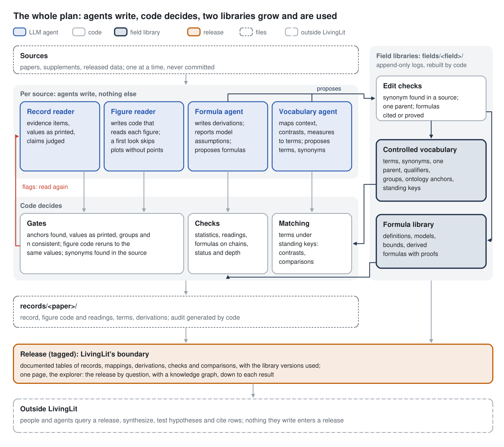

# LivingLit

> [!WARNING]
> **Work in progress.** Records are written by LLM agent jobs and checked by code, but not yet by people. Treat a
> verdict as a pointer to where a paper and its record disagree, and check the record (and the paper) before citing it.

LivingLit is a **living literature review built on audited paper records**. LLM agents read each paper; code checks
everything a rule can decide; papers meet only where code finds that their mapped terms match. It checks
**consistency, not truth**: whether each paper's numbers follow from its own methods and statistics, and which results
from different papers can be compared at all.

- **The audit.** Each paper becomes a record: every value as printed, with an anchor (a short quote and its place) and
  its origin (*stated*, *from data*, *read* from a figure by code, or *derived by LivingLit*); the paper's claims,
  judged against the results they rest on; and the verdict of every check code can run.
- **Two field libraries**, grown by agents and checked by code: a **controlled vocabulary** for context and measures,
  anchored to public ontologies, and a **formula library** that checks every derived quantity.
- **The release**: documented tables rebuilt from the records, with every cross-paper comparison computed by code, and
  one page for exploring them. Synthesis happens outside, citing rows.



*Blue boxes are LLM agents, grey boxes are code, dark boxes are the field libraries, dotted boxes are files.*

## Case study: hiPSC-derived cardiomyocyte models

The papers are drawn from the studies cited by a recent review of the field:

> Ewoldt JK, DePalma SJ, Jewett ME, *et al.* Induced pluripotent stem cell-derived cardiomyocyte in vitro models:
> benchmarking progress and ongoing challenges. *Nature Methods* 22, 24–40 (2025).
> [doi:10.1038/s41592-024-02480-7](https://doi.org/10.1038/s41592-024-02480-7)

The review analysed some 300 studies; LivingLit has recorded 50 so far. The review's own curated table is never shown
to the agents, and the case study tests how much of the same ground can be covered from the papers alone.

[](https://elejeune11.github.io/LivingLit-public/)

**[Open the explorer →](https://elejeune11.github.io/LivingLit-public/)** An example of how to explore LivingLit (where
papers meet, which comparisons hold, whether the numbers check out, whether the claims follow, what is missing), down
to each result's values, checks, derivations and context.

| Release run-2026-11-13 | |
|---|---|
| Papers recorded and audited | 50 (2014–2022), from 47 labs |
| Results (one measurement or comparison each) | 7,704 |
| Claims judged against their results | 2,641 |
| Reported values, as printed, each with its origin | 95,825 |
| Vocabulary | 1,076 terms (version 69) |
| Formula library | 87 entries (version 33): 50 given with citations, 37 derived and proved by code |
| Cross-paper comparisons computed by code | 35,798 |

Most comparisons hold only if some context is set aside, because a paper did not state it. What a paper does not
state is unknown, not different, and every verdict names what it assumes.

<details><summary>The 50 papers</summary>

| Record | Paper | Lab |
|---|---|---|
| [`2014_Yang`](records/2014_Yang/) | Tri-iodo-L-thyronine promotes the maturation of human cardiomyocytes-derived from induced pluripotent stem cells (2014). [doi:10.1016/j.yjmcc.2014.04.005](https://doi.org/10.1016/j.yjmcc.2014.04.005) | Murry lab, University of Washington |
| [`2015_Guyette`](records/2015_Guyette/) | Bioengineering Human Myocardium on Native Extracellular Matrix (2015). [doi:10.1161/CIRCRESAHA.115.306874](https://doi.org/10.1161/CIRCRESAHA.115.306874) | Ott lab, Massachusetts General Hospital |
| [`2015_Hinson`](records/2015_Hinson/) | Titin Mutations in iPS cells Define Sarcomere Insufficiency as a Cause of Dilated Cardiomyopathy (2015). [doi:10.1126/science.aaa5458](https://doi.org/10.1126/science.aaa5458) | Seidman lab, Harvard Medical School / Brigham and Women's Hospital |
| [`2016_Han`](records/2016_Han/) | Cell alignment induced by anisotropic electrospun fibrous scaffolds alone has limited effect on cardiomyocyte maturation (2016). [doi:10.1016/j.scr.2016.04.014](https://doi.org/10.1016/j.scr.2016.04.014) | Xu lab, Emory University School of Medicine / Georgia Institute of Technology |
| [`2016_Herron`](records/2016_Herron/) | Extracellular Matrix–Mediated Maturation of Human Pluripotent Stem Cell–Derived Cardiac Monolayer Structure and Electrophysiological Function (2016). [doi:10.1161/CIRCEP.113.003638](https://doi.org/10.1161/CIRCEP.113.003638) | Jalife lab, Center for Arrhythmia Research, University of Michigan |
| [`2016_Kerscher`](records/2016_Kerscher/) | Direct hydrogel encapsulation of pluripotent stem cells enables ontomimetic differentiation and growth of engineered human heart tissues (2016). [doi:10.1016/j.biomaterials.2015.12.011](https://doi.org/10.1016/j.biomaterials.2015.12.011) | Lipke lab, Auburn University |
| [`2016_Lind`](records/2016_Lind/) | Instrumented cardiac microphysiological devices via multimaterial three-dimensional printing (2016). [doi:10.1038/NMAT4782](https://doi.org/10.1038/NMAT4782) | Parker lab and Lewis lab, Wyss Institute and SEAS, Harvard University |
| [`2016_Mannhardt`](records/2016_Mannhardt/) | Human Engineered Heart Tissue: Analysis of Contractile Force (2016). [doi:10.1016/j.stemcr.2016.04.011](https://doi.org/10.1016/j.stemcr.2016.04.011) | Eschenhagen and Hansen lab, Department of Experimental Pharmacology and Toxicology, University Medical Center Hamburg-Eppendorf |
| [`2016_Masumoto`](records/2016_Masumoto/) | The myocardial regenerative potential of three-dimensional engineered cardiac tissues composed of multiple human iPS cell-derived cardiovascular cell lineages (2016). [doi:10.1038/srep29933](https://doi.org/10.1038/srep29933) | Keller lab, University of Louisville |
| [`2016_Ruan`](records/2016_Ruan/) | Mechanical Stress Conditioning and Electrical Stimulation Promote Contractility and Force Maturation of Induced Pluripotent Stem Cell-Derived Human Cardiac Tissue (2016). [doi:10.1161/CIRCULATIONAHA.114.014998](https://doi.org/10.1161/CIRCULATIONAHA.114.014998) | Murry lab, University of Washington |
| [`2016_Schwan`](records/2016_Schwan/) | Anisotropic engineered heart tissue made from laser-cut decellularized myocardium (2016). [doi:10.1038/srep32068](https://doi.org/10.1038/srep32068) | Campbell lab, Yale University |
| [`2017_Correia`](records/2017_Correia/) | Distinct carbon sources affect structural and functional maturation of cardiomyocytes derived from human pluripotent stem cells (2017). [doi:10.1038/s41598-017-08713-4](https://doi.org/10.1038/s41598-017-08713-4) | Alves and Serra lab, iBET / ITQB-NOVA, Oeiras |
| [`2017_Mills`](records/2017_Mills/) | Functional screening in human cardiac organoids reveals a metabolic mechanism for cardiomyocyte cell cycle arrest (2017). [doi:10.1073/pnas.1707316114](https://doi.org/10.1073/pnas.1707316114) | Hudson lab, School of Biomedical Sciences, The University of Queensland |
| [`2017_Richards`](records/2017_Richards/) | Inspiration from heart development: Biomimetic development of functional human cardiac organoids (2017). [doi:10.1016/j.biomaterials.2017.07.021](https://doi.org/10.1016/j.biomaterials.2017.07.021) | Mei lab, Clemson University / Medical University of South Carolina |
| [`2017_Shadrin`](records/2017_Shadrin/) | Cardiopatch platform enables maturation and scale-up of human pluripotent stem cell-derived engineered heart tissues (2017). [doi:10.1038/s41467-017-01946-x](https://doi.org/10.1038/s41467-017-01946-x) | Bursac lab, Department of Biomedical Engineering, Duke University |
| [`2017_Tiburcy`](records/2017_Tiburcy/) | Defined Engineered Human Myocardium With Advanced Maturation for Applications in Heart Failure Modeling and Repair (2017). [doi:10.1161/CIRCULATIONAHA.116.024145](https://doi.org/10.1161/CIRCULATIONAHA.116.024145) | Zimmermann lab, Institute of Pharmacology and Toxicology, University Medical Center Goettingen |
| [`2018_Abilez`](records/2018_Abilez/) | Passive Stretch Induces Structural and Functional Maturation of Engineered Heart Muscle as Predicted by Computational Modeling (2018). [doi:10.1002/stem.2732](https://doi.org/10.1002/stem.2732) | Wu lab, Stanford University |
| [`2018_Gao`](records/2018_Gao/) | Large Cardiac Muscle Patches Engineered From Human Induced-Pluripotent Stem Cell-Derived Cardiac Cells Improve Recovery From Myocardial Infarction in Swine (2018). [doi:10.1161/CIRCULATIONAHA.117.030785](https://doi.org/10.1161/CIRCULATIONAHA.117.030785) | Jianyi (Jay) Zhang lab, Department of Biomedical Engineering, University of Alabama at Birmingham |
| [`2018_Leonard`](records/2018_Leonard/) | Afterload promotes maturation of human induced pluripotent stem cell derived cardiomyocytes in engineered heart tissues (2018). [doi:10.1016/j.yjmcc.2018.03.016](https://doi.org/10.1016/j.yjmcc.2018.03.016) | Sniadecki lab and Murry lab, University of Washington |
| [`2018_Mosqueira`](records/2018_Mosqueira/) | CRISPR/Cas9 editing in human pluripotent stem cell-cardiomyocytes highlights arrhythmias, hypocontractility, and energy depletion as potential therapeutic targets for hypertrophic cardiomyopathy (2018). [doi:10.1093/eurheartj/ehy249](https://doi.org/10.1093/eurheartj/ehy249) | Denning lab, Department of Stem Cell Biology, Centre of Biomolecular Sciences, University of Nottingham |
| [`2018_Ronaldson-Bouchard`](records/2018_Ronaldson-Bouchard/) | Advanced maturation of human cardiac tissue grown from pluripotent stem cells (2018). [doi:10.1038/s41586-018-0016-3](https://doi.org/10.1038/s41586-018-0016-3) | Vunjak-Novakovic lab, Columbia University |
| [`2018_Ulmer`](records/2018_Ulmer/) | Contractile Work Contributes to Maturation of Energy Metabolism in hiPSC-Derived Cardiomyocytes (2018). [doi:10.1016/j.stemcr.2018.01.039](https://doi.org/10.1016/j.stemcr.2018.01.039) | Hansen and Eschenhagen lab, University Medical Center Hamburg Eppendorf |
| [`2019_Dwenger`](records/2019_Dwenger/) | Chronic optical pacing conditioning of h-iPSC engineered cardiac tissues (2019). [doi:10.1177/2041731419841748](https://doi.org/10.1177/2041731419841748) | Keller lab, Kosair Charities Pediatric Heart Research Program, Cardiovascular Innovation Institute, University of Louisville |
| [`2019_Goldfracht`](records/2019_Goldfracht/) | Engineered heart tissue models from hiPSC-derived cardiomyocytes and cardiac ECM for disease modeling and drug testing applications (2019). [doi:10.1016/j.actbio.2019.05.016](https://doi.org/10.1016/j.actbio.2019.05.016) | Sohnis Research Laboratory for Cardiac Electrophysiology and Regenerative Medicine, Technion - Israel Institute of Technology |
| [`2019_Kaiser`](records/2019_Kaiser/) | Optimizing Blended Collagen-Fibrin Hydrogels for Cardiac Tissue Engineering with Human iPSC-derived Cardiomyocytes (2019). [doi:10.1021/acsbiomaterials.8b01112](https://doi.org/10.1021/acsbiomaterials.8b01112) | Coulombe lab, Center for Biomedical Engineering, Brown University |
| [`2019_Yang`](records/2019_Yang/) | Fatty Acids Enhance the Maturation of Cardiomyocytes Derived from Human Pluripotent Stem Cells (2019). [doi:10.1016/j.stemcr.2019.08.013](https://doi.org/10.1016/j.stemcr.2019.08.013) | Murry lab, University of Washington |
| [`2019_Zhao`](records/2019_Zhao/) | A Platform for Generation of Chamber-Specific Cardiac Tissues and Disease Modeling (2019). [doi:10.1016/j.cell.2018.11.042](https://doi.org/10.1016/j.cell.2018.11.042) | Radisic lab, University of Toronto (with Backx lab) |
| [`2020_Buikema`](records/2020_Buikema/) | Wnt Activation and Reduced Cell-Cell Contact Synergistically Induce Massive Expansion of Functional Human iPSC-Derived Cardiomyocytes (2020). [doi:10.1016/j.stem.2020.06.001](https://doi.org/10.1016/j.stem.2020.06.001) | Sean Wu lab, Cardiovascular Institute, Stanford University School of Medicine |
| [`2020_Feyen`](records/2020_Feyen/) | Metabolic Maturation Media Improve Physiological Function of Human iPSC-Derived Cardiomyocytes (2020). [doi:10.1016/j.celrep.2020.107925](https://doi.org/10.1016/j.celrep.2020.107925) | Mercola lab, Cardiovascular Institute and Department of Medicine, Stanford University |
| [`2020_Garbern`](records/2020_Garbern/) | Inhibition of mTOR Signaling Enhances Maturation of Cardiomyocytes Derived From Human-Induced Pluripotent Stem Cells via p53-Induced Quiescence (2020). [doi:10.1161/CIRCULATIONAHA.119.044205](https://doi.org/10.1161/CIRCULATIONAHA.119.044205) | Lee lab, Department of Stem Cell and Regenerative Biology, Harvard University |
| [`2020_Giacomelli`](records/2020_Giacomelli/) | Human-iPSC-Derived Cardiac Stromal Cells Enhance Maturation in 3D Cardiac Microtissues and Reveal Non-cardiomyocyte Contributions to Heart Disease (2020). [doi:10.1016/j.stem.2020.05.004](https://doi.org/10.1016/j.stem.2020.05.004) | Mummery lab, Department of Anatomy and Embryology, Leiden University Medical Center |
| [`2020_Huang`](records/2020_Huang/) | Enhancement of human iPSC-derived cardiomyocyte maturation by chemical conditioning in a 3D environment (2020). [doi:10.1016/j.yjmcc.2019.10.001](https://doi.org/10.1016/j.yjmcc.2019.10.001) | Reich lab, Johns Hopkins University (with Tomaselli, Johns Hopkins Hospital) |
| [`2020_Richards`](records/2020_Richards/) | Human cardiac organoids for the modelling of myocardial infarction and drug cardiotoxicity (2020). [doi:10.1038/s41551-020-0539-4](https://doi.org/10.1038/s41551-020-0539-4) | Mei lab, Bioengineering Department, Clemson University |
| [`2020_Rupert-C`](records/2020_Rupert-C/) | Human Cardiac Fibroblast Number and Activation State Modulate Electromechanical Function of hiPSC-Cardiomyocytes in Engineered Myocardium (2020). [doi:10.1155/2020/9363809](https://doi.org/10.1155/2020/9363809) | Coulombe lab, Brown University |
| [`2020_Saleem-U`](records/2020_Saleem-U/) | Force and Calcium Transients Analysis in Human Engineered Heart Tissues Reveals Positive Force-Frequency Relation at Physiological Frequency (2020). [doi:10.1016/j.stemcr.2019.12.011](https://doi.org/10.1016/j.stemcr.2019.12.011) | Hansen lab, Department of Experimental Pharmacology and Toxicology, University Medical Center Hamburg-Eppendorf |
| [`2021_Bliley`](records/2021_Bliley/) | Dynamic loading of human engineered heart tissue enhances contractile function and drives a desmosome-linked disease phenotype (2021). [doi:10.1126/scitranslmed.abd1817](https://doi.org/10.1126/scitranslmed.abd1817) | Feinberg lab, Carnegie Mellon University (with van der Meer lab, University Medical Center Groningen) |
| [`2021_Knight`](records/2021_Knight/) | Maturation of Pluripotent Stem Cell-Derived Cardiomyocytes Enables Modeling of Human Hypertrophic Cardiomyopathy (2021). [doi:10.1016/j.stemcr.2021.01.018](https://doi.org/10.1016/j.stemcr.2021.01.018) | Song lab, University of Colorado Anschutz Medical Campus |
| [`2021_Silva`](records/2021_Silva/) | Co-emergence of cardiac and gut tissues promotes cardiomyocyte maturation within human iPSC-derived organoids (2021). [doi:10.1016/j.stem.2021.11.007](https://doi.org/10.1016/j.stem.2021.11.007) | McDevitt lab, Gladstone Institutes |
| [`2021_Tsan`](records/2021_Tsan/) | Physiologic biomechanics enhance reproducible contractile development in a stem cell derived cardiac muscle platform (2021). [doi:10.1038/s41467-021-26496-1](https://doi.org/10.1038/s41467-021-26496-1) | Helms lab, University of Michigan |
| [`2021_Tsui`](records/2021_Tsui/) | Tunable Electroconductive Decellularized Extracellular Matrix Hydrogels for Engineering Human Cardiac Microphysiological Systems (2021). [doi:10.1016/j.biomaterials.2021.120764](https://doi.org/10.1016/j.biomaterials.2021.120764) | Deok-Ho Kim lab, Johns Hopkins University |
| [`2021_Zhang`](records/2021_Zhang/) | Plakophilin-2 truncating variants impair cardiac contractility by disrupting sarcomere stability and organization (2021). [doi:10.1126/sciadv.abh3995](https://doi.org/10.1126/sciadv.abh3995) | Chen lab, Boston University |
| [`2021_deLange`](records/2021_deLange/) | Human iPSC-engineered cardiac tissue platform faithfully models important cardiac physiology (2021). [doi:10.1152/ajpheart.00941.2020](https://doi.org/10.1152/ajpheart.00941.2020) | Ralphe lab, Department of Pediatrics, University of Wisconsin School of Medicine and Public Health |
| [`2022_Afzal`](records/2022_Afzal/) | Cardiac ultrastructure inspired matrix induces advanced metabolic and functional maturation of differentiated human cardiomyocytes (2022). [doi:10.1016/j.celrep.2022.111146](https://doi.org/10.1016/j.celrep.2022.111146) | Kshitiz lab, University of Connecticut Health |
| [`2022_Ergir`](records/2022_Ergir/) | Generation and maturation of human iPSC-derived 3D organotypic cardiac microtissues in long-term culture (2022). [doi:10.1038/s41598-022-22225-w](https://doi.org/10.1038/s41598-022-22225-w) | Forte lab, Center for Translational Medicine, International Clinical Research Centre (FNUSA-ICRC), St. Anne's University Hospital, Brno |
| [`2022_Garay`](records/2022_Garay/) | Dual inhibition of MAPK and PI3K/AKT pathways enhances maturation of human iPSC-derived cardiomyocytes (2022). [doi:10.1016/j.stemcr.2022.07.003](https://doi.org/10.1016/j.stemcr.2022.07.003) | Perlingeiro lab, Lillehei Heart Institute, University of Minnesota |
| [`2022_Huebsch`](records/2022_Huebsch/) | Metabolically driven maturation of human-induced-pluripotent-stem-cell-derived cardiac microtissues on microfluidic chips (2022). [doi:10.1038/s41551-022-00884-4](https://doi.org/10.1038/s41551-022-00884-4) | Healy lab, Department of Bioengineering, University of California at Berkeley |
| [`2022_Ronaldson-Bouchard`](records/2022_Ronaldson-Bouchard/) | A multi-organ chip with matured tissue niches linked by vascular flow (2022). [doi:10.1038/s41551-022-00882-6](https://doi.org/10.1038/s41551-022-00882-6) | Vunjak-Novakovic lab, Columbia University |
| [`2022_Shen`](records/2022_Shen/) | Physiological calcium combined with electrical pacing accelerates maturation of human engineered heart tissue (2022). [doi:10.1016/j.stemcr.2022.07.006](https://doi.org/10.1016/j.stemcr.2022.07.006) | Campbell lab, Department of Biomedical Engineering, Yale University |
| [`2022_Strimaityte`](records/2022_Strimaityte/) | Contractility and Calcium Transient Maturation in the Human iPSC-Derived Cardiac Microfibers (2022). [doi:10.1021/acsami.2c07326](https://doi.org/10.1021/acsami.2c07326) | Huaxiao Yang lab, Department of Biomedical Engineering, University of North Texas |
| [`2022_Wickramasinghe`](records/2022_Wickramasinghe/) | PPARdelta activation induces metabolic and contractile maturation of human pluripotent stem cell-derived cardiomyocytes (2022). [doi:10.1016/j.stem.2022.02.011](https://doi.org/10.1016/j.stem.2022.02.011) | Dubois lab, Icahn School of Medicine at Mount Sinai |

</details>

## How it works

Each paper goes through a few short, headless agent jobs, each with a brief in
[`readers/instructions/`](readers/instructions/). A job writes files and reports; the runner then runs the job's
**gate** (code) itself and resumes the job with the gate's output until it passes, or parks the paper for a person.

| Job | Writes | Gate |
|---|---|---|
| Record reader | `record.yaml`: units, results, groups and context, values as printed, claims, anchors | anchors found in the text; values as printed; every field filled or *not stated* |
| Figure reader | `figures/*.py`, code that reads one figure, and the values it reads | the code reruns to the same values; every reading has an interval |
| Vocabulary agent | `terms.yaml`: mappings and proposed terms | every synonym found in the paper; one parent per term; ontology ids exist |
| Formula agent | `derived.yaml`: how each derived value was built | every input is a recorded value; new formulas cited or proved by code |

Which agent runs is configuration: copy [`agent.example.yaml`](agent.example.yaml) to `agent.yaml` and give the
command line of any headless LLM coding agent. The code in `src/livinglit/` is generic; everything about hiPSC-CMs
lives in [`fields/hipsc_cm/`](fields/hipsc_cm/).

The design is in [`docs/minimalist_design/`](docs/minimalist_design/README.md) and wins over the code:
[goal](docs/minimalist_design/01-goal.md) ·
[audit](docs/minimalist_design/02-audit.md) ·
[vocabulary](docs/minimalist_design/03-vocabulary.md) ·
[formulas](docs/minimalist_design/04-formulas.md) ·
[across sources](docs/minimalist_design/05-across-sources.md) ·
[releases](docs/minimalist_design/06-releases.md) ·
[building](docs/minimalist_design/07-building.md) ·
[trials and decisions](docs/minimalist_design/08-trials-and-decisions.md) ·
[case study](docs/minimalist_design/09-first-corpus.md).

## Use

Needs Python 3.10+, [uv](https://docs.astral.sh/uv/), and poppler (`pdftotext`) to read papers.

```bash
uv sync
uv run pytest                              # tests that need papers or ontology files are skipped without them
uv run livinglit release my-release        # audit every record; write releases/my-release/ (needs the ontologies)
open releases/my-release/explorer.html
uv run livinglit audit 2014_Yang           # one record's audit
uv run livinglit add 2023_Example          # read a new paper: every job to a passing gate
```

A release needs the pinned ontology files but not the papers. Adding a paper needs its files in
`papers_dont_ever_commit/<year>_<Author>/` (git-ignored); [`docs/adding-papers.md`](docs/adding-papers.md) describes an
unattended run over a batch.

```
src/livinglit/         generic code (nothing about any field)
fields/hipsc_cm/       the case study's vocabulary, formula library, standing keys and ontology pins
readers/instructions/  the agents' briefs
records/<paper>/       the 50 audited records: record.yaml, figures/*.py, readings.yaml, data.yaml, terms.yaml, derived.yaml
docs/                  the design, its figures, and how to add papers
site/                  the latest release's explorer, served by GitHub Pages
tests/                 one test per rule, each citing the design tab it comes from
```

## Ontologies

Terms are anchored to these public ontologies where one fits. The releases are pinned with checksums in
[`fields/hipsc_cm/ontologies.yaml`](fields/hipsc_cm/ontologies.yaml); download them into `ontologies_dont_commit/`
(git-ignored). Each is used under its own licence.

| Ontology | Used for | Pinned release |
|---|---|---|
| [ChEBI](https://www.ebi.ac.uk/chebi/) (`chebi_core.obo.gz`) | small molecules, drugs, supplements | 257 |
| [Cell Ontology](https://obofoundry.org/ontology/cl.html) (`cl-basic.obo`) | cell types | 2026-06-08 |
| [MONDO](https://mondo.monarchinitiative.org/) (`mondo.obo`) | diseases | 2026-11-03 |
| [Units of Measurement](https://github.com/bio-ontology-research-group/unit-ontology) (`uo.obo`) | units | 2026-10-12 |
| [Cellosaurus](https://www.cellosaurus.org/) (`cellosaurus.txt`) | cell lines | 57.0 |
| [NCBI Taxonomy, taxslim](https://obofoundry.org/ontology/ncbitaxon.html) (`taxslim.obo`) | species | 2026-07-12 |

## Not in this repository

Papers, supplements, source data and figures (records hold anchors, values and quotes of at most 30 words; a test
guards this), the ontology files, and the source review's curated table.

## Related work

- **BoxGraph** ([github.com/elejeune11/boxgraph-public](https://github.com/elejeune11/boxgraph-public)): values as
  printed, verdicts at printed precision, figures read by code, readings kept apart from corrections, records rebuilt
  rather than edited. LivingLit's formula library is BoxGraph's models cut to closed-form algebra.
- **Discourse graphs** (Chan, Akamatsu, Vargas, Kawerau and Gartner, *Steps Towards an Infrastructure for Scholarly
  Synthesis*, [arXiv:2407.20666](https://arxiv.org/abs/2407.20666), 2024; [discoursegraphs.com](https://discoursegraphs.com)):
  an early inspiration. LivingLit keeps their insistence on evidence tied to one result of one source, and joins
  sources through matched terms instead of written links.
- **Living literature reviews** (Wijkstra et al., K-CAP 2021, [arXiv:2111.00824](https://arxiv.org/abs/2111.00824)).
- **The source review's curated table** (Ewoldt, DePalma et al. 2025; Dryad
  [doi:10.5061/dryad.ksn02v7bh](https://doi.org/10.5061/dryad.ksn02v7bh)): an example of the information to parse from
  the literature. It is never shown to the agents.

## Status and licence

A research prototype, shared to gather feedback. Open questions are listed in
[tab 8](docs/minimalist_design/08-trials-and-decisions.md#open); [`CONTRIBUTING.md`](CONTRIBUTING.md) lists the rules
the code and tests enforce. MIT licence ([`LICENSE`](LICENSE)) for the code and records; the papers remain under their
publishers' and authors' terms.
