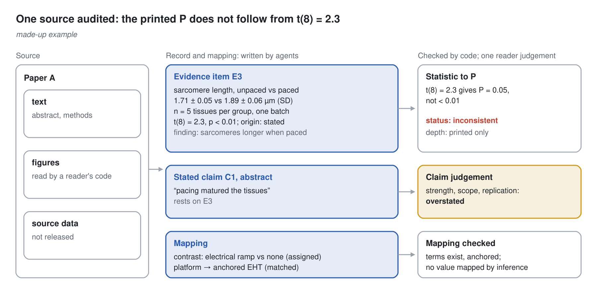
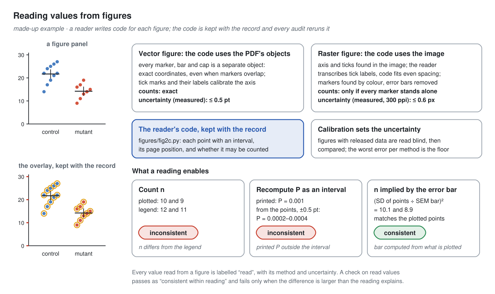

# 2 · The audit

The audit reads one source at a time into a **record** and checks it against itself: values as printed, verdicts at printed precision, nothing corrected. Sources are audited independently and in parallel. This is LivingLit's main contribution.

*Figure 2 · one source audited (made-up example)*

Agents write the record and its mapping; code checks the statistics and the mapping and sets the status; a reader judges the claim against its own evidence.

## What a record holds

| Item | What it is |
| --- | --- |
| **Evidence item** | one measurement or test, anchored: its measure (and definition), method and software, its context, the **groups** it measures or compares, what n counts and how many, statistics as reported, and a one-line finding as the source reports it |
| **Stated claim** | one assertion the source makes, quoted, with scope, direction, strength, the evidence items it rests on, any of its own evidence that opposes it, any other stated claim it restates, and the reader's judgement (below) |
| **Attributed claim** | a statement crediting another source, resting on nothing in this one; a claim about the literature ("the first to show") is marked the same way |
| **Citation** | a citing sentence, its purpose (attributes a finding, borrows a method, value or data, contrasts), and what it cites |
| **Cross-reference** | where the source refers to itself ("Fig. 5d") |
| **Reading** | values read from a figure by code a reader wrote, each with an interval, a page position and an overlay |
| **Derivation** | for a derived measure, the formula the methods state, its inputs and each parameter's kind ([tab 4](04-formulas.md)) |
| **Mapping** | for every stated context (a unit's or a group's) and measure: its terms, or a flag ([tab 3](03-vocabulary.md)); kept in its own file so a vocabulary change never edits the record |

**Units.** A paper is broken into **units**. A unit is one experiment as the paper presents it: usually one figure; part of a figure when it mixes experiments (Fig. 2a–c and Fig. 2d–f are two units); a table; or a result stated only in text. Each unit stands alone as a contribution: an id `<paper>/<unit>` (e.g. `2021_Zhang/F4`), a `where` (figure, panels or table), its own context, its own evidence items, readings and data, and its own audit status (sound or not) and depth. Every table is a unit. A result stated only in the text is a unit (`TXT1`…). Supplementary figures and tables are units when an item rests on them. Ids: `F1`, `F2ac`, `T1`, `S3`, `TXT1`.

**Field sets.** A record names the field set it was read against (`field_set`). A field added to the field's vocabulary later resolves to *not yet read* in that record: an unknown, filled at the next re-map checkpoint, never a gate failure. Records written for the new set must fill it. Adding a field therefore never forces a re-read of every paper.

**Context per unit.** A record has a `default_context` (only what holds for the whole paper), `units:` (each with its id, `where`, `title` as the paper words it, and its own context), and evidence items that name their `unit`. An item's context is the default, then its unit's block, then its group's (below), then the item's own overrides. Code resolves it, and the resolved context is never stored. A field whose value differs between units is written in each unit and may not appear in `default_context`; code checks this. This keeps a paper-wide value from leaking into units where it does not apply; the repetition is cheap because identical stated text is mapped once ([tab 3](03-vocabulary.md); decision 13 in [tab 8](08-trials-and-decisions.md)).

**Context is anchored too.** Each distinct stated context value of a record (one per field and wording, as it is mapped) carries one anchor in `context_anchors`: a quote in which its words and numbers appear, or its by-reference citation; *not stated*, *not applicable* and declared states need none. Code checks that the quote holds the value. The rule applies to records read against field set 3 or later. Without it, inferences get through that only a person reading the reports catches, such as a day computed from protocol durations ([tab 8](08-trials-and-decisions.md)).

**Groups.** A unit lists its groups as the paper shows them: `groups: {<id>: {label: as printed, context: {...}}}`. A group's context holds what sets it apart within the unit: the fields, numbers included, that differ among the unit's groups. Everything else comes from default → unit, so an item's context for a group is default → unit → group → item. A group has a `kind`: *engineered* (the default), *native tissue*, or *other study* (another study's data, with its citation). A native or other-study group resolves only its own context: every field it does not state is *not stated in this source*, never inherited from the paper's default or unit context. Code labels a pair with such a group *against benchmark*: it has no contrast and no confound, and it is used for value comparisons only. Otherwise a native tissue would inherit the paper's culture conditions and every pair with it would be a confound.

**A group's set is its complete list.** Where a field holds a set (treatment, supplements), each group lists every member the paper gives for it, and writes absence explicitly when the paper states it ("insulin: none", "without insulin"). Code reads each group's set as complete for that group: groups that differ in which members they hold (glucose, palmitate, insulin) are factorial on those members (`treatment[insulin]`). A member missing from a group whose set the paper does not give is unknown; the field is then *not stated* for that group.

**Model and simulation outputs** (finite-element fields, fitted curves the paper computes, not measures) are not evidence items and not groups. A step the paper derives is a derivation ([tab 4](04-formulas.md)); anything else is left out and logged.

A level of a number inside one experiment (a pacing frequency, a dose, a time point) is its own group, with the number in its context, so a test along a frequency or dose is a test between groups and code computes the contrast on the number. A test between two measures in the same samples (force against calcium transient) is a derivation (a ratio, [tab 4](04-formulas.md)), not a contrast.

**One evidence item per printed test.** An item is one printed measurement or test, and names the groups it involves:

- `groups: [g]` for a measurement;
- `compares: [a, b]` for a pairwise test (a t-test, or one post-hoc pair such as Tukey);
- `compares: [g1, g2, g3, …]` with `test_of: omnibus` (an ANOVA across groups, with no pairwise result); code makes no pairwise comparison from it;
- `compares: {condition: [groups], reference: [groups]}` with `test_of: main effect`;
- `test_of: interaction` with the groups involved.

For example, Shen F5 has groups HC-NP, HC-RP, LC-NP and LC-RP. The pacing main effect compares {HC-RP, LC-RP} with {HC-NP, LC-NP}; "HC-RP vs HC-NP" is a pair. Ronaldson-Bouchard's "intensity vs other regimes, two-way ANOVA + Tukey" is one item per Tukey pair the paper prints; if no pairs are printed, it is one omnibus item comparing [control, constant, intensity].

**What code computes.** The reader never writes what varies. Code finds the fields that differ between the compared groups, on their mapped terms, quantities and qualifiers:

- For a pair, one differing field gives a contrast on that field. More than one gives a *confound*, flagged by code, not by the reader.
- For a main effect, the two sides must differ in one field and be balanced on the others.
- A unit whose groups cross k ≥ 2 factors in all combinations is labelled *factorial*, with its factors.
- Fields that vary together across every group of a unit are *aliased*. A pair that differs in aliased fields is still a confound, labelled *aliased*, and it takes no part in direction comparisons; for factorial recognition, aliased fields count as one compound factor (Shen: medium + calcium × pacing).
- Fields declared *linked* in field content (`genotype ~ disease_model`: a patient variant and the disease it models) count as one contrast on the first field when a pair differs only in them. Links are added by a person at a checkpoint, never by an agent. A cell line that also differs is still a confound (a non-isogenic control).

**Fields that can sit on parts of a record:**

| Field | Where | What |
| --- | --- | --- |
| `suspected_error: {what, why}` | any value, item or context value | a suspected error, labelled; never a correction |
| `cross_references:` | the record | places where the text cites a panel that shows something else |
| `by_reference` | a context value, a measure's `definition`, a derivation parameter | stated only by citation (below) |
| `n` with `origin: from data` | an item | n taken from released data, with a pointer to it; one n per group when groups differ |
| `spread_source` | beside `spread` | where the spread is stated: `sentence`, `legend` or `methods` |
| `software` | an item | the imaging or analysis software as stated, with version, plugin or custom code ("ImageJ 1.52 with SarcOptiM", "custom MATLAB script", "not stated") |
| `method` | an item | the acquisition and analysis method as stated; a qualifier of the measure, never part of its term |
| `stated_direction` | an item | the direction as the text words it (`up`, `down`, `none`), with its anchor; used only when no values are printed or read ([tab 5](05-across-sources.md)) |

**Ids.** Unit, group, item and value ids are `[A-Za-z0-9_]+`: no dots, spaces or slashes, because values are addressed as `<item>.values.<name>`. Code checks this.

## What a reader extracts

The reader works through the whole source, never toward a question, because a question in mind biases extraction ([tab 8](08-trials-and-decisions.md)):

- **Evidence items:** every reported measurement or comparison, whether or not a claim rests on it.
- **Stated claims:** every claim in the abstract, each results section's conclusion, the discussion's conclusions and assertive figure titles. A compound statement becomes one stated claim per assertion; the same assertion made twice is two stated claims, one marked as restating the other.
- **Attributed claims and claims about the literature** ("the first to show"): recorded and marked, not judged.
- **Context:** the field's context fields, each as stated or marked *not stated*. Mapping to terms is a separate step ([tab 3](03-vocabulary.md)).

**Values.** Values are written as printed, as strings:

- **Printed P** is read from its first `P <op> value`, ignoring annotations ("P < 0.001 (figure label)"); ".01" is 0.01; "× 10−4" is an exponent; asterisks without a stated threshold are not a P; "n.s." is P ≥ 0.05.
- A **range** ("5–36") is two values, never a mean.
- **Decreases** keep the sign as printed ("reduced by 87%"); the derivation, not the record, says it is a decrease.
- Values, n, data rows and readings attach to a group (`group: <id>`). A value that relates two groups (a difference, a ratio, "65% lower") is not a value of either group: it carries `between: [a, b]`. A value or range printed for several groups at once ("13 to 15 % in all 8× tissues") carries `over: [groups]`, and code checks it against each; the reader never picks a pair it does not print.
- A value printed twice (text and legend, table and text) is written twice, under names that differ only by a source suffix (`_text`, `_legend`, `_table`), and code checks they agree at the coarser precision.
- A value marked "~" or "≈", or printed with "about", "approximately", "roughly", "around" or "nearly", is approximate: within 10 % or one last digit, whichever is wider, it is consistent, in checks and along a derivation.
- **Several printed P for one item** (text P < 0.0001, legend n.s.) are all recorded, each with its anchor (`p_values`); code checks each, and their disagreement is a *reported twice* finding. The reader never picks one.
- **Asterisks without a stated threshold** give the named P state *significant, threshold not stated*: it allows a direction but no P check. A threshold the Methods state for the whole paper ("P < 0.05 was considered significant") is a stated threshold: the reader writes it with its source ("*P < 0.05 (Methods)").
- **A value's own normalisation.** A value may carry `expressed_as` and `normalised_to` read from its own legend or axis; code prefers them to the measure mapping's, so one wording normalised differently in two figures stays apart. A value printed in a physical unit is *absolute* (the unit states it); ΔF/F0 is *% change* and F/F0 *fold*.

## Anchors and origins

Every item is anchored: a quote found in the normalized text, a table cell, a dataset cell, text inside a figure, or a reading. A record with an unfound anchor is not used. Every value has an origin, shown wherever it is used:

| Origin | From | Precision |
| --- | --- | --- |
| **stated** | text, table or figure label | last printed digit |
| **from data** | released data | as stored |
| **read** | a figure, by a reader's code | the reading's uncertainty |
| **derived by LivingLit** | a formula applied to stated, data or read values ([tab 4](04-formulas.md)) | carried from its inputs |
| **by reference** | a cited source ("as described in [12]"); an unknown until carried from the cited source's record | as in the cited source |

**Text is extracted twice** from a PDF, with pdftotext and with PyMuPDF (a .docx with python-docx), and kept in memory only. Greek letters and µ are matched in several forms (below), and a quote is found if either text matches. A unit lost in extraction is a suspected error, not a value.

**Quote matching:**

- Normalize: NFKC, line-break hyphens joined, lower case.
- Keep the signs that change meaning (+ − ± < > = / % . ×). Drop en dashes like hyphens, because PDFs extract "α-actinin" as "–actinin". A hyphen next to "/" is a minus ("+/-", "-/-").
- Try each quote three ways: Greek letters and µ dropped; Greek as the Latin letters some fonts extract them as (α→a, β→b, µ→m); µ→u.
- Some fonts extract × as "3" and drop superscripts ("7 × 10⁵" as "7 3 105"); a quote with × is also tried that way.
- A quote is found if any variant is in either extractor's text.

Quotes are at most 30 words. A sentence interrupted by a running header or footer is quoted from the part after the break. Values inside an image (an image-only table, figure text) cannot be anchored by text; they are anchored to their unit and say so.

## Stated by reference, and papers needed for completeness

Papers often state a method, a protocol or a value only by citing another paper: "differentiated as described previously [12]", "post stiffness was calibrated as in [8]". The citing paper does not state the value, so its record cannot hold it, and without the cited paper the record is incomplete in a way that matters: its context fields stay unknown, its derivations lack parameters, and its comparisons can only be conditional ([tab 5](05-across-sources.md)).

- **The record reader marks it.** A field or parameter stated only by citation is recorded as *by reference*, with the citing sentence as its anchor and the citation it points to. It is neither filled nor *not stated*. The citation carries the purpose *borrows method* or *borrows value*.
- **Code resolves the citation** to a source by its DOI. Until a value is carried from the cited record, it is *by reference*: an unknown in matching and comparisons, never a value. Nothing is inferred from the cited paper.
- **If the cited source is not in the corpus,** code adds it to a **completeness list**: each cited paper, with every record, field, measure definition and derivation parameter that depends on it. The list is ranked by how many values across the corpus depend on each paper, so the papers that would complete the most records come first.
- **When a listed paper is added,** it is audited like any source and leaves the list.

The completeness list is part of every release ([tab 6](06-releases.md)). Adding a paper to the corpus stays a person's decision, because it means obtaining the paper; LivingLit only says which papers would help most and why.

## Reading figures

**All supplements are read; data tables give values.** Readers open every file in the paper's folder (main text, supplementary PDFs, .docx, spreadsheets). Each file is in `source.files` or in `source.not_used` with what it holds; the record gate fails on any file in neither. Each data or table file the record lists feeds values (anchors or data rows) or is in `not_used` with why; the figures-and-data gate fails otherwise. Workbooks in .xls and .xlsb are read cell by cell like .xlsx. Supplements a paper names but its folder lacks are listed in `source.missing`.

**Tables first, then points only.** Every table, in the main text or a supplement, is read for its printed values before any figure. A figure is read only when an item needs values no text, table or released data give, the item's test is one a check can verify from individual points, and the figure plots those points. No check uses a mean and error bar read from a bar, so bar charts, box plots and means with error bars are not read: a figure job that finds no points records `no_points` with what the figure shows and stops. A first look at the page may rule a figure out before its job runs ([tab 7](07-building.md), *No needless compute*); its `no_points` is marked *first look*.

When no data are released, values are read from figures by a reader, bespoke to each figure, because figures vary too much for one procedure. The reader decides which panels to read, where they are, which groups and colours they contain, and **writes the code that reads it**. The code is kept with the record (`records/<paper>/figures/`) and every audit runs it again, so a reading is rebuilt and checked like any other result.

- **Shared parts are offered, not imposed:** vector objects and markers, raster colour masks and blobs, axis calibration from matched tick labels, intervals, overlays. Nothing about a particular figure is written into the library.
- **Every value says how precisely it was read and where:** a point with an interval and a page position. An overlay draws the readings over the figure for a person to inspect; overlays are kept out of the repository.
- **Values judged by eye are never results.**
- **Uncertainty**, measured on calibration panels read blind against known data: ≤ 0.5 pt (vector), ≤ 0.6 px at 300 dpi (raster). Vector counts are exact; raster counts are used only when every marker stands alone, otherwise *not readable*. Box plots give quartiles; bars without points give no n.

**Readings and data are stored as a checked cache.** Each record keeps two committed files:

- `readings.yaml`: every value read from a figure, with its panel, group, point or summary, value, unit, interval, and the script (`figures/*.py`) that produced it.
- `data.yaml`: the values an item uses from released data, as stored, with file, sheet and cell.

For a person who wants to inspect a reading, `livinglit overlay <paper> [<figure>]` draws the stored readings over their figure, one colour per group, into a `dont_commit` folder outside the repository. Every audit reruns the figure scripts and the data pointers; a stored value that does not come back exactly fails the audit. So stored values are checked, not trusted. Everything stays rebuildable from files: the numbers live in the repository, the papers do not.

- A data row and a reading carry an optional `x` (dose, frequency, time, concentration) so curves keep their points apart.
- Each paper's helper code (`records/<paper>/figures/_util.py`) is that paper's alone: code loads it so that another paper's helper of the same name is never used.
- Page renders a reader looks at go to a temporary folder outside the repository and the papers folder, and are deleted.
- **Limits of reading.** Vector panels give exact counts. Many raster panels (markers under mean lines, overlapping markers, axis breaks) give bar means and error bars only, so no n or P check. Tick labels drawn as outlines need OCR; light-grey axes need a lighter threshold; heat maps can be read against their colour bar. Raster uncertainty is measured at 300 dpi; images embedded at other resolutions need their own calibration.

*Figure 3 (below) · Vector plots are drawing instructions, so every marker is an object with exact coordinates; raster plots are images. Both are calibrated from the tick labels, and uncertainty is measured on panels with known data.*

## Checks within a source

All computed by code.

| Check | Asks |
| --- | --- |
| **Statistic to P** | does P follow from the statistic and degrees of freedom? |
| **Summary to statistic** | do means, spreads and n give the statistic, under each spread and test? |
| **Points to P** | do the points (data or read) give the printed P? |
| **Which spread** | is the ± an SD, SEM or CI, whatever the label says? |
| **n against data or readings** | do the points per group match the printed n? |
| **n implied by an error bar** | does (SD of points ÷ SEM)² match the plotted and stated n? Within a quarter (at least 1): within reading; within half (at least 2): close; otherwise inconsistent. A bar the size of the SD (implied n about 1) is a question for *which spread* |
| **Granularity** | is a mean or percentage possible for its n? |
| **Reported twice** | do text, legend, figure, table and data agree? |
| **Against data or readings** | do printed values match? |
| **Same data** | do identical runs of values appear in separate groups? |
| **Along a derivation** | do the steps, statistics and directions hang together, and is the paper's formula consistent with the formula library? ([tab 4](04-formulas.md)) |

- **n:** "n = up to 6" is a bound (2–6), never exactly 6. "n ≥ 6" (or "at least 6", "6 or more") is a lower bound: any count of 6 or more agrees with it, and no check that needs an exact n assumes 6 (Zhao 4D: 6 and 8 points under "n ≥ 6").
- **Suspect cells:** a data cell or reading the reader logs as suspect (`suspect: {why}` in `data.yaml` or `readings.yaml`, e.g. 68 among values 0.9–3.9) is kept and reported, and every mean, direction and check that uses it runs twice, with and without it, labelled. A direction that changes is *not available (suspect cell)*. A suspect cell is still a replicate: counts of n are judged with it. A suspect cell in another item of a post-hoc family also triggers the second run.

Values are judged at their precision (t = 2.3 allows 2.25–2.35); P from read values is an interval. When something needed is not stated (test, spread, n, a parameter's kind), each alternative is tried and labelled as added.

- **Which test.** "Unpaired" is not "paired"; "Student's t test assuming unequal variances" is Welch's. A pairwise P from a post-hoc test (Tukey, Bonferroni, Šidák, Dunnett, Holm) or from a two-way ANOVA is never rechecked with a two-group test on the points. It is checked with its own library entry ([tab 4](04-formulas.md)), from points only, and only when the unit's groups determine the family of comparisons (every group of the unit has points); otherwise it says *cannot check* and names the test. The error term comes from every group of the unit. Equal variances are rarely stated, so each post-hoc pair also runs its unequal-variance form as a labelled alternative: Games–Howell beside Tukey, Welch's t beside the pooled t for Bonferroni, Šidák and Holm. In a factorial unit, a pair that differs in one factor is checked over two labelled families, all groups of the unit and the groups at the pair's level of the other factors; when the test says "within each" or "for each", only the second. The family can flip a verdict, so both are shown. An omnibus P is rechecked only when the printed test is a one-way ANOVA.
- **Units.** A printed value and points in another unit are never compared: *cannot check*, with both units named. Units are compared through axis labels ("Force [mN]" is mN) and common spellings (msec = ms). "% of baseline" and "% change" are different quantities.
- **Precision.** A value stored at machine precision in released data is compared with a relative tolerance (10⁻⁶), not at its last digit.
- **Not the paper's error.** An *inconsistent* verdict can be an artefact of the checks (test kind, ANOVA kind, unit) rather than an error in the paper ([tab 8](08-trials-and-decisions.md)). Every check therefore runs against a **gold set** (`tests/gold/`): items whose printed values an independent check confirmed against the source, each with its known verdict. A check enters or changes only when it reproduces every gold item. Every artefact an independent check finds becomes a gold item; while it is not fixed it is *open*, and it must still fail until a fix closes it.

## Status and depth

Each evidence item's status is **set by code**, never by a reader, from its own checks only:

| Status | Rule |
| --- | --- |
| **consistent** | every check passed under every alternative |
| **consistent within reading** | passed only within reading uncertainty |
| **close** | passed under some alternatives, or off in the last digit |
| **inconsistent** | a check failed under every alternative |
| **cannot check** | no check could run |

**Depth** says how far checks could go: **data**, **readings**, **printed only**, or **none**. Problems upstream of a derived item (an inconsistent input, a conflict with a formula) are separate flags beside its status, never merged into it. Bars or error bars read from a figure, without points, give depth readings.

**Findings, not item counts.** Code groups failing checks that share a cause into one **finding**: the same unit and check, and the same printed source (the printed n for one group, one data file, the unit's printed test). A finding lists the items it affects and leads the paper's page and the release (`findings.csv`); item statuses stay underneath. One legend's n for one group that differs from the data columns is one finding, however many items use it.

## A stated claim against its own evidence

A reader judges each stated claim dimension by dimension: **direction**, **support** (a test that passed its checks), **comparison** (the one claimed), **scope**, **unit of replication**, **strength** ("drives", "only", "necessary") and **presence** (shown, not just referred to). Each is *follows*, *overstated*, *does not follow* or *cannot judge*; the verdict is the worst, in the order does not follow > overstated > cannot judge > follows. Where the formula library shows a derivation error, code adds whether it changes the claim ([tab 4](04-formulas.md)). Where a claim's direction is judged *follows* but the computed direction of an item it rests on is the opposite ([tab 5](05-across-sources.md)), code flags the pair *judged direction contradicts computed direction* (only up against down; an item with no significant effect is not opposite) beside the claim's verdict; the verdict itself is not changed. Code computes the verdict; attributed claims and claims about the literature are not judged.

A claim is judged against its own source only. LivingLit does not test it against other papers; anyone can do that outside, with a release.

A **unit** is *sound* when none of its items is *inconsistent* or *close*, and its depth is the deepest of its items'. A **record** is complete when its gates pass: every anchor is found, every field of its field set is filled or marked *not stated*, every stated value is matched, mapped or flagged, and every stored reading and data value comes back when rerun.
