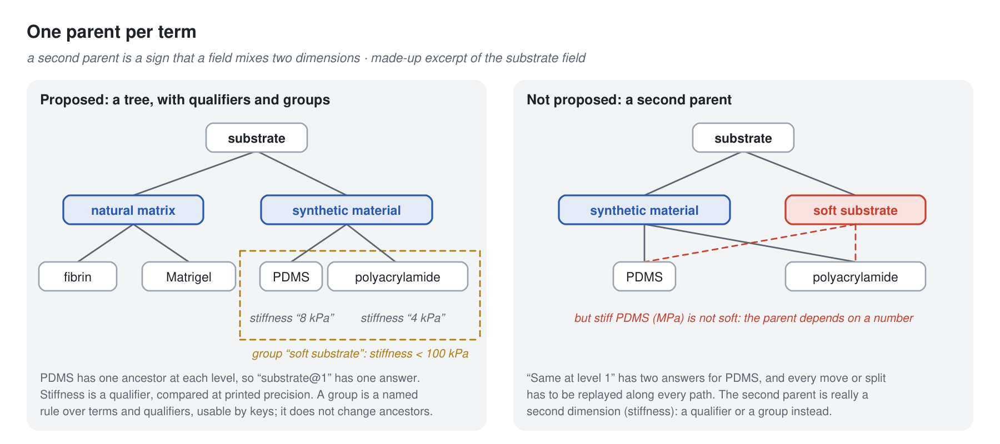
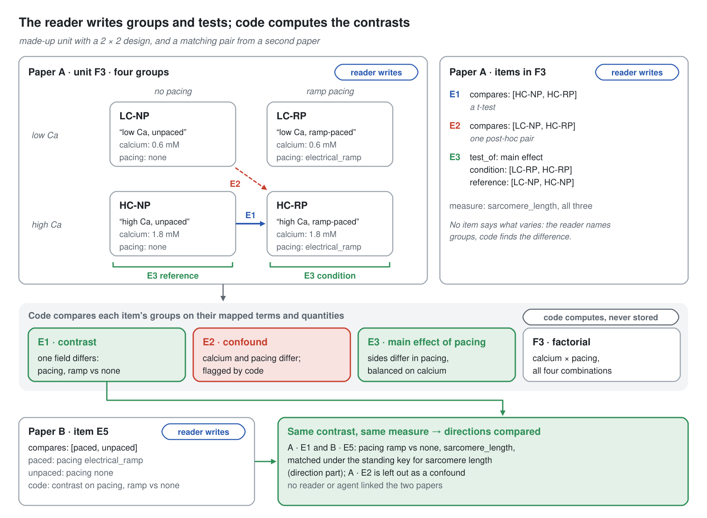

# 3 · Vocabulary and mapping

Every stated context (of a unit or a group) and measure is **mapped** to terms of the field's controlled vocabulary, and those terms are the only way papers meet. The vocabulary is built from the papers by the vocabulary agent, one paper at a time, and checked by code; no person approves terms. Code never compares free text: as strings, "8 kPa PDMS" and "PDMS, 8 kPa" differ, and "3D CMT" and "3D fibrin tissue between PDMS pillars" cannot be seen as both 3D.

## Fields and terms

A field's content declares its fields, each of a kind, in `fields/<field>/field.yaml`; `vocab.yaml` holds the fields and terms rebuilt from the edit log:

| Kind | Values | Compared by | hiPSC-CM example |
| --- | --- | --- | --- |
| **terms** | terms from the field's tree; a value may map to a set | identity and ancestry | platform, substrate, maturation strategy |
| **adopted** | ids from a pinned ontology release; a value may map to a set | identity, and ancestry in the ontology | cell line (Cellosaurus), treatment (ChEBI) |
| **quantity** | a number with a unit, as printed, plus named states | printed precision; states by identity | temperature ("37 C"; *room temperature*) |
| **measure** | what was measured, with a dimension and its formulas | identity, then derivation ([tab 4](04-formulas.md)) | contractile stress |

A term has a stable id, a label, synonyms (each found in a source's text at its anchor), **one parent**, a definition, a scope note against its siblings, optional qualifiers (stiffness, frequency) and external ids. Combinations map to **sets** of terms, never to combination terms. Numbers stay out of terms as **qualifiers** ("8 kPa PDMS" → PDMS, stiffness "8 kPa"). Cross-cutting views ("soft substrate") are **groups**: named rules usable by keys, not part of the tree.

| Term field | What | Rule (code) |
| --- | --- | --- |
| `id` | stable, never reused, independent of the label | unique; never reused, deprecated ones included |
| `label` | the preferred name | unique within the field |
| `parent` | one broader term in the same field, or none | exists; same field; no cycles |
| `synonyms` | wordings matched by code after normalization, each with the anchor where a source printed it | found in that source's text; each belongs to one term |
| `definition` | one sentence: what it is | required |
| `scope` | when to use it, against each sibling | required when it has siblings |
| `qualifiers` | named parameters with a dimension (stiffness, frequency, pattern size) | values parse with that dimension |
| `xref` | identifiers in external ontologies (Cellosaurus, ChEBI, CL, MONDO, NCBITaxon), never their hierarchies | exists and is not obsolete in the pinned release, when that ontology is pinned |
| `added` | the paper and log version whose job added it, with the agent's model and instructions | written by code |

**One parent per term** keeps "same at level k" unambiguous (a term has one ancestor at each level), makes each new term one judgement instead of a set, and keeps vocabulary changes simple. A term that wants a second parent is almost always a second dimension, and goes to a qualifier, a group or another field.

*Figure 4 · one parent per term: a tree with qualifiers and groups, and what a second parent would mean (made-up example)*

**Some fields, as examples.** `treatment` holds a drug or other exposure (ChEBI), with qualifiers dose, timing and acute/chronic; contrasts on drugs vary `treatment`. `genotype` holds gene, variant and zygosity, as its own field apart from `disease_model`; isogenic contrasts vary `genotype`. `cm_day_at_formation` is a quantity: the day of differentiation when cells were put into the platform. `differentiation_factors` is a set of ChEBI ids (or own terms) for every molecule used to differentiate.

**One thing, one field.** Mechanical load during culture has `mechanical_load` (not a platform qualifier or a treatment); an introduced gene or reporter has `transgene` (not a treatment); culture and measurement calcium are `culture_calcium_mM` and `measurement_calcium_mM`; the age of a donor or of native tissue is `donor_age`. A contrast matches across papers only when each paper puts the thing in the same field.

**Fields declare their named states** in field content, for any kind of field: temperature *room temperature*; donor age *fetal*, *neonatal*, *newborn*, *infant*, *young*, *adult*; confluency *confluent*; time point *baseline*; genotype *healthy control line* (written only when the paper calls a line a healthy, wild-type or control line). *Not stated*, *not applicable* and *none* are states of every field. Code matches a declared state; it is never mapped or flagged, and the gate refuses either. Two equal states compare *same*; a state against a term of the field is unknown, not a conflict.

**Open world.** *Not stated*, *not yet read* (a field added after the record was read), *not stated in this source* (a benchmark group's unstated field) and *by reference* (not yet carried from the cited record) are unknowns. Matching and comparisons treat them as unknown ([tab 5](05-across-sources.md)); *unmapped* and *flagged* are not unknowns: they wait on an agent or reader.

**Field sets.** Field content is versioned as field sets (`field_set` in `field.yaml`; each later field has `since`). The second set adds `species` (own terms, each with an NCBITaxon xref), `time_point` (a time within an experiment that is not a day of culture) and `measurement_medium` (the bath during measurement). The third, from the field survey (below), adds `seeding_density`, `dissociation_reagent` and `incubator_atmosphere`. Records read against an earlier set show later fields as *not yet read*.

**Quantity fields**: a quantity printed with its number in words ("four weeks") is a quantity. A qualifier that is a name (a gene, a line, a normalising condition) is compared as text, never by the digits in it.

**Relative measures** are the base measure with two measure qualifiers from small fixed lists: `expressed_as` (*absolute*, *% of baseline*, *% change*, *fold*, *normalised*) and `normalised_to` (what it is divided by, as text). ΔF/F0 and F/F0 are the calcium amplitude `expressed_as` *% change* and *fold*. A level (APD50, APD90, decay to 50 %) is the qualifier `level`. A mapping is per wording per paper, so when one wording is normalised differently in different figures, the agent leaves `normalised_to` out of the mapping and the values carry their own ([tab 2](02-audit.md)). When neither states it, code takes `expressed_as` from the value's printed unit.

**Analysis method is not a context field.** It is a qualifier `method` on the measure, and a standing key may require it to match.

## Adopted ontologies and our own terms

Where a standard ontology covers a field well, LivingLit **adopts** it instead of inventing terms. Every field says which it is, and every term shown anywhere says where it comes from: an ontology ID with its release (`CL:0000746`, CL 2026-06-08), or *LivingLit*.

| Field (hiPSC-CM) | Source | Why |
| --- | --- | --- |
| `cell_line` | adopted: Cellosaurus | every hiPSC line has an accession |
| `cell_types`, `stromal_cell`, `endothelial_cell` | adopted: Cell Ontology (CL) | cell types are what CL is for |
| `treatment`, `differentiation_factors`, `supplements` | adopted: ChEBI | small molecules and their roles |
| `disease_model` | adopted: MONDO | disease identity |
| `genotype` | own (LivingLit); a gene may carry an HGNC id | gene, variant and zygosity; kept apart from `disease_model` |
| `species` | own (LivingLit), each term with an NCBITaxon xref | a few species; the xref is checked against the pinned release |
| `platform`, `substrate`, `maturation_strategy`, assessment methods, `measure` | own (LivingLit) | the ontologies are thin here; engineering terms such as *anchored EHT* or *frequency ramp* are not in them |

The split is a starting point: a field moves to an ontology when one is found that covers its terms, and that move is a logged event like any other.

**Adopted fields:**

- **Terms are the ontology's IDs**, from a pinned release (`fields/<field>/ontologies.yaml`: file, release and checksum; the files stay out of git). Labels, definitions and hierarchy are the ontology's; LivingLit does not edit them.
- **The vocabulary agent looks the term up** in the pinned releases (`livinglit lookup`; never on the web) and maps the stated value to an ID. Code checks that the ID exists in the pinned release, is not obsolete, and carries the ontology's own label, and that the edit has a lookup note.
- **No new terms are invented.** If nothing fits, the value maps to the nearest broader ID and is reported as *no ontology term*, a request that can be sent to the ontology outside LivingLit.
- **A few own terms are allowed** in an adopted field, through the edit `adopt_own`, for what the ontology lacks: mixtures such as B27, compounds absent from ChEBI, lines absent from Cellosaurus, unnamed patient lines. Each needs a lookup note saying what was searched.
- **Synonyms found in papers may still be added,** as LivingLit synonyms pointing to the ontology ID, each anchored and labelled as ours, so code can match them next time.
- **Hierarchy:** ontologies such as ChEBI and CL give a term several parents, so "same at level k" does not apply. Instead a standing key names an ancestor class ("both under *cardiac muscle cell*"), and two terms match when both descend from it by any path. *Same* and *narrower / broader* work as in our own fields.
- **A new ontology release** is pinned in `ontologies.yaml`; every adopted ID is then checked against it again, and any made obsolete or moved is reported.
- **One ontology id may serve several fields** (CHIR99021 as a differentiation factor and as a treatment): a second `adopt` edit adds the field; the id stays one term.

**Our own fields** follow everything above: one parent per term, synonyms anchored in papers, terms added by the agent and checked by code. An own term may still carry an `xref` to an ontology class it resembles, without adopting it.

## Mapping, and flags

| Origin | Who | Stored? |
| --- | --- | --- |
| **matched** | code: every part of the stated text equals a synonym or label; a quantity parses; a named state matches | no, recomputed on every build |
| **assigned** | the agent, when no synonym matches | yes, in `records/<paper>/terms.yaml`, with the vocabulary version |
| **flagged** | the agent: the value is not one context | yes, with the flag kind |

**Flag, never infer.** A placeholder ("varies by evidence"), alternatives ("monolayer (text) or micropatterned (methods)"), several conditions or several measures in one value, a value that is not a context, or two fields that contradict each other get no term. The flag goes back to the record reader, who reads that field again from the source; the vocabulary never fills one field from another field's text. *Flagged*, *unmapped* and *not stated* are distinct results.

**Flag kinds:** *placeholder*, *alternatives*, *several conditions*, *several measures*, *not a context*, and *two fields in one* (a contradiction only).

**Two fields in one value.** The agent maps each field from its own part of the value. Words that belong to another field become a **split request** to the record reader. A split request does not block: the mapped part stands. Only a contradiction blocks: if the other field is filled and disagrees, the value is flagged *two fields in one*. Split requests are counted per paper, like flags.

**How code matches.** The stated text is normalized and split on separators ("+", ",", ";", "/", "&", "and", "with"), multi-word synonyms first. Every part must match a synonym or label for the value to be *matched*; a leftover part sends the whole value to the agent. Ancestors are dropped, so "3D CMT" gives {3D, micropillar tissue}, which reduces to *micropillar tissue*. Matches are never stored: storing them would store a value a rule computes. Mappings live in `records/<paper>/terms.yaml`, apart from the record, so a vocabulary change never edits an audit record. Identical stated text within a paper is mapped once and reused, wherever it appears (default, unit, group or item); copies of one value that differ only in wording are flagged back to the reader.

- **Write stated values short.** The reader writes each context value as the paper names the thing (a short phrase), and puts numbers and details in qualifiers or a `note`. A whole sentence ("3D cardiac microtissues between PDMS micropillars, paced at 1 Hz") never matches a synonym and goes to the agent; matching by code is what keeps the vocabulary cheap as the corpus grows.
- **A synonym must not be broader than its term.** "EHT" attached to *strip between two posts* would mis-match every other EHT format. A synonym is the paper's name for exactly this term; generic words go on the generic term or stay unmatched.
- **"Not applicable"** (pacing of a fixed sample, platform of a lysate) is a named state, not a flag.
- **A unit value that names both arms** is *several conditions*; the reader writes the arms as groups instead ([tab 2](02-audit.md)).
- **Flags and split requests go back** to the record reader through the re-read job ([tab 7](07-building.md)), one field at a time.

**Comparing on terms.** For one field, two items with term sets A and B are:

| Result | Rule |
| --- | --- |
| **same** | A = B |
| **same at level k** | equal once each term is replaced by its ancestor at depth k (own trees) |
| **same under a class** | every term of both descends from a named class (adopted fields) |
| **narrower / broader** | every term of one has an ancestor-or-self in the other |
| **differ** | none of the above |
| **unknown** | one side is *not stated*, *not yet read*, *not stated in this source* or *by reference*, or a named state meets a term |
| **unmapped** | one side is stated but has no terms yet: *cannot compare*, not *differ* |
| **flagged** | one side is flagged: *cannot compare*, with the flag as the reason |

Qualifiers are compared after terms, at printed precision. Standing keys ([tab 5](05-across-sources.md)) say which result each field needs.

## Contrasts

Most values cannot be compared across papers, but **directions against a paper's own control** often can ([tab 8](08-trials-and-decisions.md)). Readers do not write contrasts, and contrasts are not mapped as such. Each group's context is mapped like any other context value, and code computes each item's contrast from its mapped groups ([tab 2](02-audit.md)). Contrasts are evidence-level and anchored through their groups; claims are not mapped.

A contrast follows the test the paper prints ([tab 2](02-audit.md)): a pair, an omnibus test (no pairwise comparison is made from it), a main effect or an interaction. A pair whose groups differ in more than one field is a *confound*, computed by code, not flagged. The flag *several conditions* means one stated value naming several groups.

**Contrasts on a number** (calcium, day, composition, temperature, `cm_day_at_formation`; pacing 2 Hz vs 0.75 Hz; strip stiffness 1× vs 8×) come from the groups' quantities and qualifiers, and code compares the numbers. They need no extra form.

*Figure 5 · the reader writes a unit's groups and the tests it prints; code computes each item's contrast, flags a confound, and matches another paper's pair under a standing key (made-up example)*

## How the vocabulary grows

Papers are processed **one at a time, in order**, because each job sees the vocabulary its predecessors built. For each paper, **one agent** sees the vocabulary so far (every term with its label, parent, synonyms, definition and scope), the paper's stated values with anchors, and the paper, read-only. It never sees other papers' records or mappings, the validation study's files or the curated table. It writes `terms.yaml` in two parts: **mappings** (terms with qualifiers, or a flag, for every value) and **edits** (what this paper needed added, each with its reason and anchor).

For each value no synonym matches, it asks in order, and the first yes decides:

| # | Question | If yes |
| --- | --- | --- |
| 1 | Is it something other than one context (placeholder, alternatives, several conditions, several measures, not a context, two fields that contradict)? | **flag** it; no term |
| 2 | Is it the same thing as an existing term? | map it; **add a synonym** |
| 3 | Is it a combination of existing terms? | map it to the **set** |
| 4 | Does it differ only by a number or a second dimension? | existing term with a **qualifier** (or a group, or a new field) |
| 5 | Is it a kind of exactly one existing term, and could a comparison or link treat it differently? | **add a term** under that one parent |
| 6 | Otherwise | map it to the **broader term** |

**A new field** is the edit `add_field {name, kind, scope}`, open to the agent. Code checks that the name is new, the kind is *terms*, *adopted* or *quantity*, and a scope note says what belongs there (and what goes to the nearest existing field); it is logged like any edit. Linked fields ([tab 2](02-audit.md)) are added only by a person.

**Re-maps add to what was applied.** A re-map's `terms.yaml` may hold edits already in the log and new ones; code checks and appends only the edits not yet logged for that paper. A field renamed by a person's decision is the logged event `rename_field` (it renames the field in keys and terms).

**Fields are designed from the corpus, before it is read.** Fields added during a run arrive after readers have already put things in the wrong field ([tab 8](08-trials-and-decisions.md), decision 47). So a field survey fixes a field set before a corpus run (field set 3 came from one), and after that fields arrive only at checkpoints, as a new field set. Code decides the field list; no person reviews it:

1. **Sample.** Unread papers drawn every tenth from the sorted list of the folder (29 for field set 3). Nothing comes from the curated table or the validation study.
2. **Survey job per paper.** It reads the methods and figure legends only, and lists every experimental condition the paper states (not how data were analysed or reported), each with a quote, tagged with the existing field whose scope holds it, a qualifier included, or *no field*, and marked `varied` when the paper's groups differ in it. Code checks each quote holds its condition.
3. **Code counts.** A merge job names each untagged condition (which wordings are the same condition); code counts, for each name, the surveyed papers that state it and those that vary it.
4. **A rule decides.** A condition with no field becomes a new field when 3 or more surveyed papers vary it between groups (it makes contrasts) or at least a third state it (it decides whether values compare across papers); it is declared in `field.yaml` (name, kind and scope written from the merged name and its quotes) with `since` set to the new field set. Every other condition is still recorded: readers put it in the unit's or group's `other_conditions`, each with its quote, which code checks. These are not mapped to terms, so they cost no vocabulary work and never block a comparison, but they are in the record and in `values.csv` for anyone to filter on. Nothing stated is dropped. Counting only the papers that state a condition would make fields of protocol details no comparison uses ([tab 8](08-trials-and-decisions.md)), so the rule asks for varied or common conditions.
5. **Code checks, freezes, and promotes at checkpoints.** Every surveyed condition must have a home in the new field set (a field or `other_conditions`), or the survey fails. At each later checkpoint, code counts `other_conditions` across the whole corpus and promotes any condition stated in 5 % or more of the papers read (and at least 3) to a field in the next field set. Records already read get a methods-only fill job for new fields at the next checkpoint; until then those fields are *not yet read*.

**Edits only add:** a term, an adopted ID (or a further field for one), an own term in an adopted field, a synonym, a scope note, a qualifier, a field, a standing key ([tab 5](05-across-sources.md)). No earlier mapping can become wrong; at worst it is less specific than it could be. Renames, merges, splits and moves of terms are not edits; only a measurement below would justify adding them.

**What code checks before an edit is applied:** every new synonym is found in this paper's text at its anchor; no label or synonym collides with another term; an own id is `<field>:<slug>` and never reused; the parent exists in the same field; a definition, and a scope note if it has siblings; a qualifier, and a measure, has a dimension; an adopted ID passes the checks above; every value is matched, mapped or flagged, and no flagged value carries a term; no validation-study canary enters the vocabulary. A failed job goes back to the agent with code's output; a passed one is appended to `changes.yaml`, and `vocab.yaml` is rebuilt from that log.

**Earlier papers:** a new synonym makes earlier unmapped values *matched*; a new term lists earlier values under its parent as possible refinements, by paper (`refinements.csv` in the release). They are re-mapped by the same agent every 10 papers, and once more before a release.

- **One thing, one field.** The same thing landed in different fields in different papers (glucose and palmitate in `cm_medium` in one, `treatment` in another). Each field's scope note says what belongs there, and the re-map checkpoint resolves cross-field duplicates.
- **Generic terms** ("control medium") invite false *same* matches; they are allowed only with a qualifier saying what the paper calls the control.

**Measures of the vocabulary, and what each would justify adding:**

| Measure | How | Suggests adding |
| --- | --- | --- |
| new terms per paper | counted from the log by paper order, in every release | a second agent on new terms, if it does not fall |
| near-duplicate terms | close labels or synonyms within a field, in every release | merges |
| flags per field | counted in every release | changes to the record reader's instructions |
| re-map agreement | at each checkpoint, a fresh run re-maps a random 30 values, blind | a blind check of definitions, if below 85 % |
| crowded terms | at each checkpoint: many values with very different wordings under one term | splits |
| order sensitivity | at a checkpoint: papers re-mapped in a second order, groupings compared | batch rounds |

## Seeded from papers only

The vocabulary is built from the sources. It is never seeded from the validation study's normalization vocabulary or the curated table, whose spellings readers must not see; requiring every synonym to be found in a source's text enforces this.

**Re-checked on every release.** Every release first re-checks every adopted id and every own term's xref against the pinned ontology releases; a missing or obsolete one stops the release, so pinning a new release cannot silently break terms.

## Designed, not yet built

The design keeps these; the code does not do them yet (open item in [tab 8](08-trials-and-decisions.md)).

- **Groups**: named rules over terms and qualifiers ("soft substrate": stiffness < 100 kPa), usable by standing keys, outside the tree (Figure 4).
- Moving a field to an adopted ontology as a logged edit of the vocabulary.
