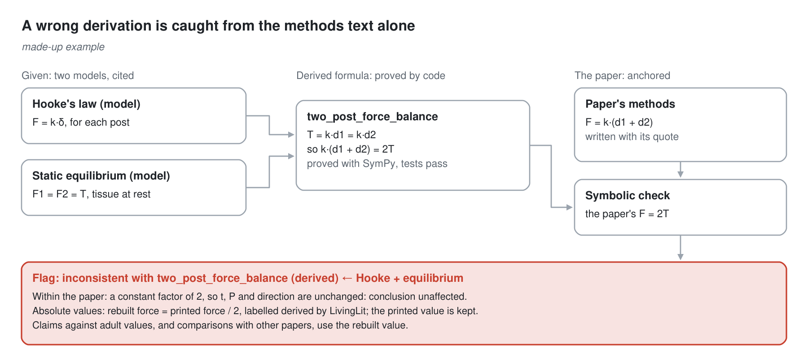
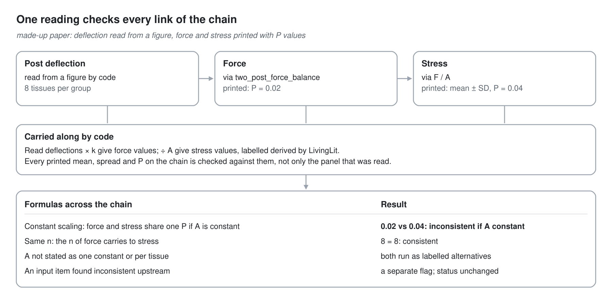

# 4 · Derivations and formulas

Many reported quantities are built from others: force from post deflection, stress from force and an area. LivingLit records how each was built, checks each step against the field's **formula library**, and carries values and statistics along the chain, so a paper's numbers are checked as a whole. This is a much simpler BoxGraph: closed-form algebra kept in one library per field, not models written per paper.

| BoxGraph | LivingLit |
| --- | --- |
| Datum: a value as printed, with origin | values with origin *stated*, *from data*, *read* or *derived by LivingLit* |
| Model: runnable code, per paper | a **derivation step**: one formula from the library in `fields/<field>/formulas/`, with dimensions |
| Run | code evaluating the chain on the record's values, data and readings |
| Comparison at printed precision | relations and statistical checks, applied along the chain |
| ModelAtlas relations and families | identity only: same formula, same parameter choices |
| Refinement; complex models | out of scope: handed to BoxGraph |

## Derivations

For each derived measure, the formula agent writes the formula the methods state (anchored), names the library entry it maps to, points each input at a value or another evidence item, and says whether each parameter is **one constant**, **per sample** or **not stated**. Unstated choices become labelled alternatives. Derivations live in `records/<paper>/derived.yaml`:

```yaml
derived:
  E12.stress:                                # made-up example
    item: E12
    measure: measure:stress
    formula: "s = F / A"                     # as the methods state it, as one equation
    anchor: {quote: "stress was calculated by dividing force by the cross-sectional area", where: Methods}
    library: {formula: stress_def, vars: {sigma: s, F: F, A: A}}
    inputs:
      F: {item: E11}                         # another evidence item, with its own groups and statistics
      A: {value: E12.values.csa_mm2, kind: constant}
    output: E12.values.stress
```

**Inputs.** Each input points at exactly one of: an `item`; a `value` (`<item>.values.<name>`, with `part: mean | spread`); a `printed` number with its anchor; `data` (a data row, `<item>/<group>`); a `reading` (`<figure>/<group>` in `readings.yaml`); `derived` (another derivation); `by_reference` (a citation); or `not_stated`. A parameter's `kind` (constant, per sample, not stated) is separate from whether its value is printed. An input from `data` or a `reading` on a curve names its `x`. A stated or printed input carries the interval of its last printed digit, so a rebuilt value whose interval holds the printed value is consistent (37.9/15.9 = 2.384 against a printed 2.39). A per-sample formula judged against a printed mean carries `aggregation` (*mean of per-sample*, *of means*, *not stated*); an unstated one runs as labelled alternatives.

**Library or no formula.** Each derivation names a library entry (`library: {formula, vars}`) or gives `no_formula` with a reason.

**Outputs and chains.** A derivation names its `output`: the printed value it produces, so code can rebuild and judge it. Steps may chain, with one derivation's output as another's `derived:` input.

**Per group.** A derivation is per item; where the groups have different inputs, write one derivation per group (`<item>.<name>_<group>`, with `group:`), and the group must be one of the item's unit.

**Chains use every number available:** printed values, and the means of data rows and readings. Printed inputs alone leave most derivations *cannot check* ([tab 8](08-trials-and-decisions.md)).

**A named operation is a stated formula.** "Fold change", "% of baseline" and "coefficient of variation" name their formula; the derivation maps them to the library with the words as the anchor. A method stated only by citation maps to no formula and goes on the completeness list ([tab 2](02-audit.md)).

**Version.** A `derived.yaml` (and a `terms.yaml`) keeps the library version it was gated against; a later library does not make it invalid. Code re-checks it against the current library on every build.

**Bounds.** `derived.yaml` may list `bounds:`, each naming an item, one of its values and a bound entry from the library; code applies the bound to the value.

## The formula agent

Derivations and formulas are a physics and statistics judgement, not a language one, so they get their own agent rather than sharing the vocabulary agent's job. One skill per job means one gate, one set of instructions and one set of failure modes per agent.

- **When it runs:** per paper, after the vocabulary agent (a formula's `applies_when` uses mapped terms). A paper with no derived quantities gets `derived: {}` and a `reason_if_empty`.
- **What it sees:** the record, its mapped terms, data and readings, the formula library so far, and the paper, read-only.
- **What it writes:**
  1. `derived.yaml`: each derivation as the methods state it, with inputs and parameter kinds (above);
  2. **assumption reports:** for each model a derivation uses, the values the paper reports that bear on each of its assumptions, or *not stated*;
  3. **bounds** to apply to the record's values;
  4. **proposals** for the formula library, when no entry covers a step (below).
- **What it never does:** declare a paper wrong. Every verdict ("inconsistent with model", "outside bound", "conclusion unaffected") comes from code. Its own physics knowledge reaches the library only as proposals that pass the formula checks.

**Assumption reports are what code alone cannot do.** Code can check a formula against the library, but not whether a model's assumptions hold for this paper. The agent finds what the paper reports; code decides:

```yaml
assumptions:                                  # in derived.yaml (made-up example)
  E11.force:
    model: cantilever_tip_stiffness
    assumptions:
      small deflection:                       # the model's assumption, by its library name
        reported: {deflection: E11.values.max_deflection_um, post_length: E11.values.post_length_um}
        limit: {ratio: [E11.values.max_deflection_um, E11.values.post_length_um], max: 0.1}
        # code: 12 um / 500 um = 2.4 %, under 10 % → holds
      linear elastic material:
        reported: not stated                  # → "not stated", a finding in itself
```

Code gives each assumption a verdict: *holds* or *fails* where a numeric limit applies, *reported* where values are given without one, and *not stated*. An assumption that holds keeps the check at full strength; one that fails turns a conflict into "the model does not apply here"; one not stated is reported as such. The gate requires every named assumption to be one of the model's, and every reported value to resolve to a value path or a quote found in the paper.

## The formula library

Each entry is one formula: its equations, its variables and their dimensions, its assumptions, where it does not apply, its tests, and one of four **kinds**. The kind says how strong a conflict with it is.

| Kind | What it is | Status | A conflict with it means | Examples |
| --- | --- | --- | --- | --- |
| **definition** | true by construction | given, with a citation | the paper contradicts a definition: an error | stress = force / area; conduction velocity = distance / time; mean, SD, SEM, t |
| **model** | an approximation, valid under stated assumptions | given, with a citation | the paper is inconsistent with the model, or the model's assumptions do not hold for it | Hooke's law (linear, small deflection); small-deflection cantilever stiffness; the t distribution (normality, independence) |
| **bound** | an inequality a value must satisfy | given, with a citation | an impossible value | fractions in [0, 1] |
| **derived** | proved by code from other entries | proved (sympy) | as strong as its weakest premise: one that rests on a model holds only under that model's assumptions | force from strain, modulus and area; t unchanged under constant scaling |

The given entries (definitions, models and bounds) are textbook statements. Correctness rests on them, so they are where a person's attention goes if they audit, and the list is kept short: proposals prefer a derived entry proved from accepted ones. A derived entry's `holds_under` is collected by code from its premises, never written by hand. An entry, as a file in the library (written by code from the log):

```yaml
formula: force_from_strain_modulus_area
kind: derived
statement: For a linear elastic specimen of Young's modulus E and area A, elongated by d over length L, the normal force is F = E*A*d/L.
equations: [F = E*A*d/L]
variables: {F: force, E: modulus, A: area, d: length, L: length, sigma: stress, eps: dimensionless}
assumes: [eps = d/L]
uses:                                          # premises; code proves the equations from them
  - {formula: stress_def, subs: {sigma: sigma, F: F, A: A}}
  - {formula: linear_elastic_stress_strain, subs: {sigma: sigma, E: E, eps: eps}}
does_not_apply: a nonlinear material or large strains; an area other than the one carrying the force
tests:
  - {given: {E: 10, A: 2, d: 1, L: 4}, expect: {F: 5}}
  - {given: {E: 10, A: 2, d: 1, L: 4}, does_not_apply: "strain taken as d/(L + d): 4.0, not 5.0"}
```

A given entry has no `uses` and carries `cites` (a text with a quote or URL); a model lists what it `assumes`. An entry may also name `applies_when`: the vocabulary terms its context must carry.

**Dimensions** are checked structurally, so `v = d/(t2 − t1)` checks. A library variable of dimension `D`, `D2`… means "the same dimension as the other `D` variables", for ratios and percentages of like quantities.

**Names in stated formulas:** `pi`, `exp`, `log`, `sqrt` are constants and functions; every other name, `E` included, is a variable.

**Percent:** a value in "%", "% of baseline", "% change", or printed with "%" is a fraction ×100 for bounds and chains.

**Reductions** (mean, root mean square, sums of parts) are library entries of their own (`mean_def`, `root_mean_square`, `sum_of_parts`).

**Given entries cite a textbook or standard.** The library at version 33 holds 87 entries: 50 given (28 definitions, 21 models, 1 bound) and 37 derived, 27 of them shared statistical entries (below).

**Examples** from the hiPSC-CM library:

| Entry | Kind | Catches |
| --- | --- | --- |
| `stress_def`: σ = F / A | definition | missing or double normalization |
| `conduction_velocity_def` | definition | CV inconsistent with printed distance and activation times |
| `cantilever_tip_stiffness`, `circular_second_moment` | model, definition | a k inconsistent with the post's modulus and geometry |
| `hooke_spring` | model (linear, small deflection) | force inconsistent with deflection and stiffness |
| `fraction_bounds` | bound | impossible fractions |
| `force_from_strain_modulus_area` | derived (definition + model) | a force inconsistent with strain, modulus and area |

Code checks the paper's **formula against the library symbolically** (no printed numbers needed), the **numbers** where the parts are available, and **dimensions and bounds** on every step.

**Every flag says how strong it is,** by kind, and points back to its premises:

- "contradicts definition: stress_def";
- "inconsistent with model: cantilever_tip_stiffness (holds under: small deflection, …)";
- "outside bound: fraction_bounds";
- "inconsistent with derived formula: two_post_force_balance (holds under: linear spring, small deflection, tissue at rest) ← hooke_spring (model) + static_equilibrium (model)" (the case in Figure 6).



*Figure 6 · two given models, a derived formula, and a flag on a paper (made-up example)*

## Statistical formulas

The statistical entries are field-independent: they live in `fields/_shared/formulas/`, which every field's library extends. They are written once by the build (`stats_library.py`), not by a paper's agent, as given entries citing a statistics handbook, and each passes the formula checks:

- definitions: mean, SD, SEM = SD/√n, coefficient of variation; the two-sample t statistic, pooled and Welch, and the paired t; one-way and two-way ANOVA F; the Tukey–Kramer and Games–Howell q; Holm, Holm–Šidák, Šidák and Bonferroni adjustments;
- models: the t, F, χ², normal and studentized range distributions, under normality and independence, giving P from a statistic and its degrees of freedom; the CI95 half-width; first-order propagation of spread through a ratio or product (inputs independent).

From these, code proves the derived entries:

| Entry | Says |
| --- | --- |
| `constant_scaling_mean`, `constant_scaling_t` | under y = c·x, means and SDs scale by c; t and P are unchanged |
| `constant_shift_t` | under y = x + c, t and P are unchanged |
| `ratio_of_means_constant_denominator` | the ratio of means equals the mean of ratios only if the denominator is constant |
| `normalized_to_own_control` | a control normalised to itself is 1 with SD 0 |

**P along a constant scaling** applies `constant_scaling_t`: P for a derived measure and its input must agree in significance when the scaling parameter is one constant; a difference rules the constant out.

**The checker handles statistics as algebra:** summary-statistic variables (a mean, an SD and an n per group), and distribution functions as named functions that tests evaluate numerically. Post-hoc tests (Tukey HSD, Holm, Šidák, Bonferroni) and the two-way ANOVA F (main effects and interaction) are checked from points (released or read) only, never from summaries, and only when the unit's groups determine the family of comparisons ([tab 2](02-audit.md)). Each was accepted after reproducing P values a paper prints ([tab 8](08-trials-and-decisions.md)). Equal variances are rarely stated, so unequal-variance forms run beside them as labelled alternatives: `games_howell_q` beside Tukey–Kramer, Welch's t beside the pooled t. Anything beyond that (mixed models, repeated measures, Dunnett) is not in the library; a check that needs it says *cannot check* and names the test.

**Every statistical check cites its entry:** "Summary to P: inconsistent with t_two_sample_welch (model: normality, independence)", not an anonymous verdict. The checks in [tab 2](02-audit.md) evaluate these entries' equations rather than code of their own, so a person can audit the statistics the same way as the physics.

## Checking a chain

1. Each item's own checks run ([tab 2](02-audit.md)).
2. **Values are carried along the chain:** data or readings of one panel give derived values (labelled derived by LivingLit) against which the printed output is judged at printed precision. A reading of one panel checks the others.
3. Formulas across the chain apply: the paper's formula against the library, matching P under constant scaling, how means were built (`aggregation`), bounds and assumptions.
4. **Same n along the chain:** a derived value carries the n of the measured (per-sample) input it is computed from, for the same group, so the unit of replication is carried through; a constant input carries no n. A derived n larger than its input's is *inconsistent*; a smaller one (derived on a subset of the measured samples) cannot be checked.
5. Unknown parameter kinds or aggregations run as labelled alternatives.
6. An inconsistent input gives the derived item a separate flag; its own status is unchanged.



*Figure 7 · one chain checked link by link (made-up example)*

## Wrong derivations

When a rebuilt value is inconsistent with the printed one, code asks whether the error changes the conclusion. A **constant factor** between them (2×, as in summing both posts' deflections, or a power of ten) leaves t, P and direction unchanged: the flag reads "conclusion unaffected (constant_scaling_t), absolute values off". The rebuilt value is reported beside the printed one, labelled derived by LivingLit; the printed value is never changed.

**Rebuilt values are used across sources.** When a group's printed value comes from a wrong derivation (the paper's formula contradicts the library, or printed and rebuilt values differ by a constant factor) and code rebuilt it, comparisons with other papers use the rebuilt value, in the printed value's unit; the spread is scaled with it only for a constant factor, otherwise no spread is known and a value verdict is not available. Each comparison row lists the sides compared on a rebuilt value (`rebuilt`), so a verdict on a rebuilt value is never read as one on the printed value ([tab 5](05-across-sources.md)). Numbers that are off for another reason, such as a mean of per-sample ratios printed where code can only rebuild the ratio of means, keep the printed value.

## New formulas: proposed by the agent, checked by code

The formula agent may propose a formula when none covers a step. The formula and the paper go through code together; if the formula fails, it is rejected and reported, the step is marked *no formula* and the paper still goes through. **Every proposed formula must pass, all by code:**

1. **A kind,** and for it: a definition, model or bound cites a source that states it (a quote or URL), and a model states its assumptions; a derived formula names its premises and is proved from accepted entries, none held as suspect.
2. **Dimensions agree** in every equation.
3. **Tests pass,** including one case where the formula does *not* apply.
4. **No contradiction** with existing entries: its test values satisfy every entry over the same variables.
5. **Applicability** (`applies_when`) names vocabulary fields and terms.

**How code proves a derived formula.** Equations are proved by Groebner reduction for polynomial systems. When that fails (exponentials such as 2^-ΔΔCt, or a ratio that holds only after dividing by a nonzero variable), code substitutes, preferring symbols a premise is linear in and nonzero solutions, and confirms the result numerically. Derived inequalities are not proved, so they are not accepted as derived entries; an inequality enters as a cited bound.

**Auditing, for a person who wants to:** one formula per file, written by code from an append-only log (`changes.yaml`), like the vocabulary; the explorer's Formulas view shows each entry with its equations, kind, premises, what it holds under, citation and uses ([tab 6](06-releases.md)); every flag points back to its premises; `livinglit formula check <name>` replays an entry's checks. A person can revoke an entry, or hold it as *suspect* so it is not applied, with a logged event. Nothing waits for a person.

**Scope.** LivingLit checks consistency of a source with itself and with a short list of declared formulas (definitions, models, bounds, and what code derives from them), and every verdict names the formula and its kind. Anything beyond closed-form algebra (large-deflection beams, finite elements, traction reconstruction) is handed to BoxGraph.

**Use and conflict, reported; suspect, decided.** Every release reports, per entry, the papers and derivations that use it and the share of papers in conflict with it (`formulas.csv`). Code never marks an entry suspect from that share: many papers conflicting with one entry may mean the field shares an error, which is a finding, not a bad entry. *Suspect* is a logged decision by a person, after reading the conflicts.

## Designed, not yet built

The design keeps these; the code does not do them yet (open item in [tab 8](08-trials-and-decisions.md)).

- Code also asks **which formula** the printed numbers fit, when they fit a different entry than the one the paper names.
- A factor that differs between groups is reported as "conclusion may change"; a constant factor as "conclusion unaffected".
- Rebuilt values in claims against adult values: this needs a table of adult reference values, which LivingLit does not have yet (comparisons already use rebuilt values).
- `applies_when` is checked when an entry is applied, not only when it is proposed.
