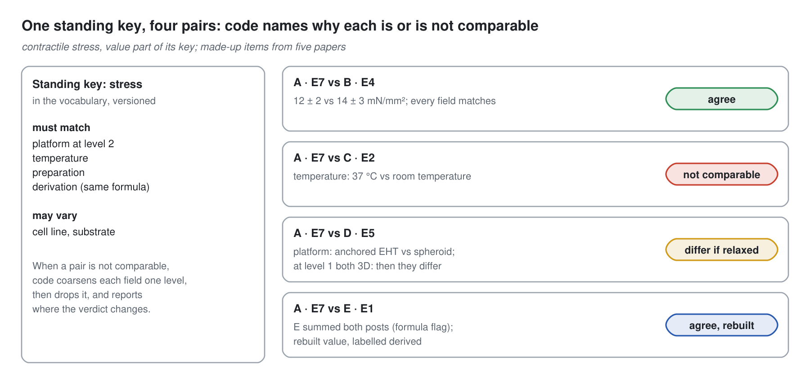

# 5 · Across sources

Sources meet in one way only: **their mapped terms match**. Code makes every edge, computes every comparison, and names the field when items cannot be compared. No reader or agent links two sources.

## Standing keys

Each measure in the vocabulary carries a **standing key**: which fields must match, and at which level of their tree, for two values of it to be compared, and which may vary. It has two parts, because an effect against its own control tolerates differences an absolute value does not:

```yaml
measure:twitch_stress:
  value:     {must_match: [platform@1, preparation, pacing, temperature, measurement_calcium_mM, mechanical_load,
                           treatment, genotype, disease_model], may_vary: [cell_line]}
  direction: {must_match: [contrast, pacing], may_vary: [cell_line, day_of_measurement]}
```

Keys are field content, kept in the vocabulary (`standing_keys` in `vocab.yaml`), versioned in its log and written by the vocabulary agent, checked by code (every field exists; levels exist). A measure without a key uses the field's `default_key` in `field.yaml`. A release publishes one computed answer per key; anyone may run other keys outside it.

- **Keys may name measure qualifiers** (`measure.gene`, `measure.normalised_to`), declared on the measure or an ancestor, so fold changes of different genes are never compared.
- **Measures with a level or a normalisation** (APD50/90, decay to 50/80 %, ΔF/F0 vs F/F0, % of baseline vs % change) carry them as measure qualifiers (`level`, `expressed_as`, `normalised_to`, [tab 3](03-vocabulary.md)); value keys require them, direction keys require `level` only. `normalised_to` applies only to relative values: two absolute values match on it.
- **What changes a value is in its value key.** Value keys of functional measures require `treatment`, `genotype` and `disease_model`; with open-world matching an unstated genotype is an assumption, not a block, and the state *healthy control line* lets a paper's own words make it known.
- **A rate that pacing sets is keyed on pacing.** Beat rate and any measure an electrical stimulus can entrain require `pacing` in both keys, so a possibly entrained rate is not compared with a spontaneous one.
- **Keys start loose and tighten.** Most items state neither a derivation nor a method, so a key requires `derivation` or `method` only where values are known to differ by them ([tab 8](08-trials-and-decisions.md)). An unstated method blocks a value comparison but not a direction comparison. A key that names `derivation` compares two values only when both were built by the same library formula.
- **Keys are revisited at each checkpoint.** The first paper that adds a measure writes its key; the re-map agent revises it once more papers use the measure, as a logged edit.
- The relaxation report (below) is the most useful output for a person ("comparable if platform@1, drop pacing").

## Comparisons

For each measure, code compares every pair of evidence items from different papers whose terms satisfy the key; each comparison row names both items and their units:

| Verdict | Meaning |
| --- | --- |
| **not comparable** | a must-match field is known to differ, or is unmapped or flagged; the field and the reason are named |
| **agree** / **differ** | one quantity, compared within spreads: each side's SD (a stated SD, a stated SEM × √n when one n is printed, or the SD of released or read points), the difference judged against the combined SD; *not available (no spread)* when a side has none, never *differ*; *not comparable (units)* when the units are different quantities |
| **same direction** / **differ in direction** | effects against their own controls, for matching contrasts |
| **differ in significance** | one item has an effect, the other none |
| **not available** | a direction is missing for one item |

**Three-valued matching (open world).** For each must-match field a pair is *known-same*, *known-different*, or *unknown* (a side has it *not stated*, *not yet read*, *not stated in this source* or *by reference*). Known-different makes the pair *not comparable*. Unknowns alone do not block: code computes the verdict and lists the fields it **assumes** match (`assumes` in `comparisons.csv`). A verdict with an empty `assumes` is **confirmed**; the release reports confirmed and conditional verdicts apart, and a person or a query keeps or drops conditional ones. This makes completeness a named premise (principle 10) instead of a silent block. In release run-2026-11-12, about 2.3 million pairs gave 35,798 computed verdicts, nearly all conditional (3 confirmed value verdicts); genotype, temperature, disease model and pacing were the most assumed fields.

When a verdict is *not comparable*, code coarsens each blocking field one level, then drops it, and reports where the verdict changes ("comparable if platform@1, drop pacing").

**Strata, not pairs.** For one measure and its key, the items whose key fields carry the same known terms form a **stratum**; each item lists its own unknowns. An item unknown on a key field forms its own stratum and is linked to each stratum it could join, the link naming what it assumes; a known difference makes no link. A stratum with items from two or more papers is a comparison: its values, spreads and directions sit side by side, and confirmed verdicts are computed within it, conditional ones along its links. The release lists strata (`strata.csv`: stratum, measure, part, key signature, items, papers, values with spreads, verdicts, unknowns, links) and keeps in `comparisons.csv` only the pairs with a computed verdict, not every pair. Release run-2026-11-12 has 12,888 strata, 42 of them with items from two or more papers.

**The dataset comes before the verdicts.** Few papers state all the context a strict comparison needs, and few test the same manipulation, so cross-paper verdicts are sparse. The main cross-paper product is `values.csv` with every context term and every unknown explicit, which a person filters for their own question; strata and verdicts are a convenience built on it.

**Matching contrasts.** Two items are direction-comparable when their computed contrasts ([tab 2](02-audit.md)) vary the same field, with group terms that match under the key. A main effect compares like a pair.

**Direction is computed, never read from words.** An item's direction is up or down from its groups' values (stated means first, then the mean of released or read points, then read bar means) when the printed P is significant, and *none* when it is not significant. A pair labelled *against benchmark* or *aliased* ([tab 2](02-audit.md)) has no direction. When there are no values, the reader's `stated_direction` ([tab 2](02-audit.md)) is used, and it is flagged everywhere it travels: the item shows *direction: stated, not computed*; a comparison that uses one reads *same direction (stated)* or *differ in direction (stated)*; and the release tables carry a `direction_origin` column (`computed` or `stated`), so a person can keep or drop them. Parsing a finding's words for direction proved unreliable (negation, "similar improvement", multi-gene summaries; [tab 8](08-trials-and-decisions.md)).



*Figure 8 · one standing key applied to four pairs (made-up example)*

## Shared data and materials

- **Data** reused from another source is linked by identifier, not copied; unstated reuse is flagged.
- **Materials** carry public identifiers (Cellosaurus for cell lines); one identifier used for different materials is flagged.
- **Independence:** evidence from one lab, dataset or donor line counts once in any count across sources.
- **Borrowed values:** a value a source takes from another (a citation with purpose *borrows value*) is checked by code against the cited source when both are in the corpus and mapped to the same measure: *as cited* or *differs*.

## Coverage and gaps

Computed from the mappings (`coverage.csv`): for each field and term, how many sources and labs use it and how many mappings carry it; and for each field, how often it is *not stated*, *flagged* or otherwise without a term. A source's profile (its platforms, measures, contrasts) is computed the same way, never written.

**Trends are analysis, outside the release.** Coverage trends by year, terms that co-occur, and combinations no source has measured are analyses of the release, not part of it; the explorer may compute them for display and says so ([tab 6](06-releases.md)).

## What is not computed

LivingLit does not decide that two stated claims say the same thing, that one source's evidence supports another source's claim, or what a set of papers shows. Those are syntheses; they are built outside, on a release, and cite it ([tab 6](06-releases.md)). Testing a claim against the corpus is one such use: map its scope to terms and query the release.

## Designed, not yet built

The design keeps these; the code does not do them yet (open item in [tab 8](08-trials-and-decisions.md)).

- Shared data and materials, as described above, are not computed yet. Deferred: in release run-2026-11-12, the 50 papers come from 47 labs, and of 35,798 comparisons only 279 pair two papers of one lab, none with a value or direction verdict.
