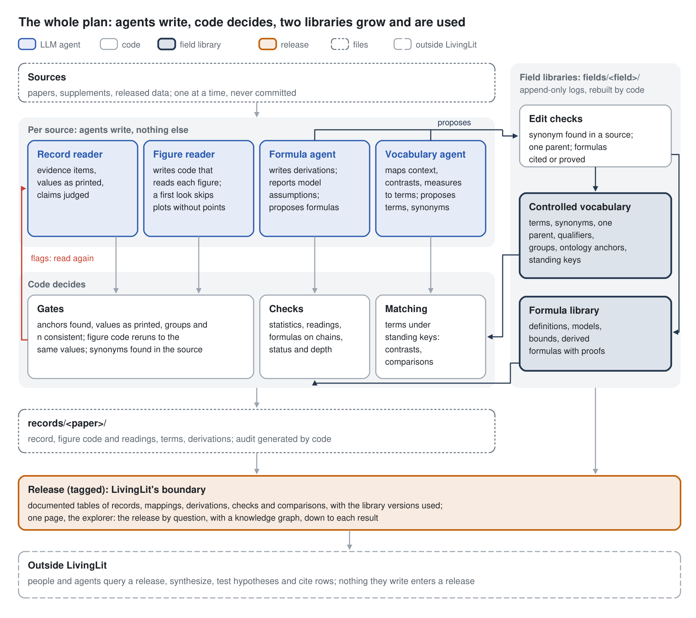

# LivingLit · Design Docs

2026-11-13 · @Emma Lejeune

## In one paragraph

LivingLit is a living literature review where **each paper is parsed into an audited record**. LLM readers write; code checks. A record holds anchored evidence items (values as printed, each with its origin), the paper's stated claims judged against its own evidence, its context and groups **mapped to a controlled vocabulary**, and its derived quantities checked against a declared **formula library**. Papers meet only where their mapped terms match: comparisons, coverage and independence are computed by code under standing keys, and no LLM ever decides that two papers are related via other mechanisms. The product is the records and what code computes from them. Exploring them (search, synthesis, hypotheses, agents) happens outside LivingLit, by whoever uses a release, citing what it rests on. Each release also carries one page built by code from its tables, the explorer, which shows the release by question, with the knowledge graph of papers and the terms that link them, down to each result.

## At a glance

*Figure 1 · the whole plan: agents write, code decides, two field libraries grow and are used*

Blue boxes are LLM agents, grey boxes are code, dark boxes are the two field libraries, dotted boxes are files (sources and records). Per source, a record reader writes the record and a vocabulary agent maps it to the controlled vocabulary and proposes new terms; where there are derived quantities, a formula agent writes the derivations, reports what the paper says about each model's assumptions, and proposes new formulas; code checks each proposal before it enters a library, and the next paper reads the grown libraries. Matching uses the vocabulary and its standing keys; checks use the formula library. Values that are not one context go back to be read again (red). A release is what others use; exploration stays outside.

## Names

| Name | What it is |
| --- | --- |
| **Source** | a paper, supplement or dataset |
| **Record** | one source, audited: evidence items, stated claims, citations, readings, derivations, each anchored, and every check's verdict |
| **Evidence item** | one measurement or comparison, with its context, its groups, n and statistics as reported |
| **Term** | an entry of the field's controlled vocabulary: a stable id, a label, synonyms found in papers, one parent |
| **Mapping** | a stated value tied to terms: *matched* by code, *assigned* by an agent, or *flagged* as not one context |
| **Contrast** | what an evidence item compares, computed by code from its groups' terms: the field that differs between them |
| **Formula** | an entry of the field's formula library, of one kind: a *definition*, a *model* (with its assumptions) or a *bound*, given with a citation; or *derived*, proved by code |
| **Reading** | values read from a figure by code a reader wrote for it, each with an interval |
| **Standing key** | for one measure, which fields must match (and at which level) for two values to be compared |
| **Comparison** | a verdict computed by code between items whose terms match under a standing key |
| **Release** | a tagged, documented set of tables generated from the files; LivingLit's boundary |
| **Explorer** | a static page code builds from a release: papers and units, the vocabulary, formulas and comparisons; nothing on it is new |
| **First look** | a cheap read-only look at a figure's page that may rule out a figure job when the figure plots no points |

## Reading order

1. [**The goal:**](01-goal.md) the problem, three kinds of statement, the principles.
2. [**The audit:**](02-audit.md) one source at a time, checked against itself.
3. [**Vocabulary and mapping:**](03-vocabulary.md) how stated context becomes terms, and how the vocabulary grows.
4. [**Derivations and formulas:**](04-formulas.md) derived quantities, the formula library that checks them, and statistics along a chain.
5. [**Across sources:**](05-across-sources.md) the only edges: matched terms, standing keys, computed comparisons.
6. [**Releases and use:**](06-releases.md) the tables LivingLit publishes, and exploration outside it.
7. [**How it is built:**](07-building.md) tests, jobs, the runner and gates, adding papers unattended, files.
8. [**Trials and decisions:**](08-trials-and-decisions.md) what the trials taught us, why the discourse graph was dropped, and the open decisions.
9. [**First corpus:**](09-first-corpus.md) the Ewoldt review: the papers recorded so far, the fields, and what remains.

## Where this comes from

- **BoxGraph** ([github.com/elejeune11/boxgraph-public](https://github.com/elejeune11/boxgraph-public)): values as printed, verdicts at printed precision, figures read by code, readings kept apart from corrections, records rebuilt rather than edited. LivingLit's formula library is BoxGraph's models cut to closed-form algebra.
- **Discourse graphs** (Chan, Akamatsu, Vargas, Kawerau and Gartner, *Steps Towards an Infrastructure for Scholarly Synthesis*, arXiv:2407.20666, 2024; [discoursegraphs.com](https://discoursegraphs.com)): an early inspiration. LivingLit's v4 design was built on their questions, claims, evidence and sources; v5 keeps their insistence on evidence tied to one result of one source, and joins sources through matched terms instead of written links.
- **Living literature reviews** (Wijkstra et al., K-CAP 2021, arXiv:2111.00824).
- **The first corpus:** the 300 studies of Ewoldt, DePalma et al., *Nature Methods* 22, 24–40 (2025), and their curated table (Dryad doi:10.5061/dryad.ksn02v7bh) as an example of the type of information to parse from the literature.
